# Cam Depot for ATAK — User Guide

**Version 1.8 · takwerx**

**Download Cam Depot 1.8** (pick the one matching your ATAK-CIV version, sideload, then load it in ATAK's Plugins manager):

- **ATAK-CIV 5.6:** https://github.com/takwerx/cam-depot/releases/download/v1.8/ATAK-Plugin-CamDepot-1.8--5.6.0-civ-release.apk
- **ATAK-CIV 5.7:** https://github.com/takwerx/cam-depot/releases/download/v1.8/ATAK-Plugin-CamDepot-1.8--5.7.0-civ-release.apk
- **ATAK-CIV 5.8:** https://github.com/takwerx/cam-depot/releases/download/v1.8/ATAK-Plugin-CamDepot-1.8--5.8.0-civ-release.apk

All releases: https://github.com/takwerx/cam-depot/releases

Cam Depot puts public traffic and wildfire cameras on the ATAK map — roughly
43,000 of them across 55 states and provinces, from state departments of
transportation, the FAA, and the wildfire lookout networks. You pick an area,
filter down to what you want, and bring it in. Tap a camera for its latest
picture; where the agency publishes a stream, play it as live video inside ATAK.

---

## Before you start

Published builds exist for **ATAK-CIV 5.6, 5.7 and 5.8**. Plugins are matched to
the ATAK release they were built against, so download the one for the ATAK
version on your device — a mismatch will not load, and the failure does not look
like a version problem.

Cam Depot needs outbound HTTPS for the catalog, and whatever port the agency
serves its own pictures and video on. No account, no key, no configuration, and
no TAK server involvement. It does not read or transmit your position, callsign,
or any other ATAK data.

---

## 1. Opening it

Load the plugin from ATAK's Plugins manager, then open it from the toolbar. The
icon sits with the other tools, and tapping it again closes the panel.

The first thing it does is load the catalog, then the cameras for the state it is
showing. A line at the top of the panel says so while it works.

---

## 2. The panel

The panel is the control. The map shows exactly what the panel selects, never the
whole catalog.

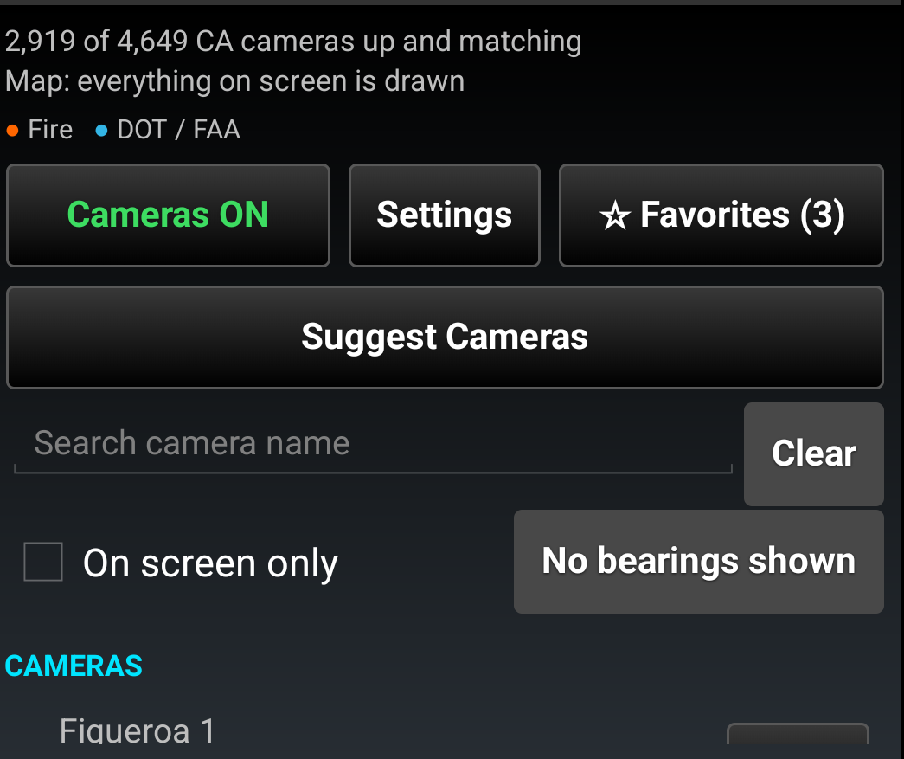

The main screen is what you use in the field:

- **Cameras ON / OFF** is the map's switch. Green draws the cameras the panel
  selects; red takes them off the map and changes nothing else.
- **Settings** opens everything that is set once and left: where, what kind,
  distance, how far Suggest Cameras reaches, and the zoom gate.
- **Favorites** pins the cameras you starred above the list.
- **Suggest Cameras** finds the cameras that cover a spot. See [Suggest
  Cameras](#4-suggest-cameras).
- **Search** finds a camera by name, in every state at once.
- **On screen only** narrows the list to the current map view and follows it.
- **No bearings shown / Turn off N bearings** puts every bearing line away.

The status line above it all says how many cameras are up and matching, what
Suggest Cameras is doing, and whether the map is drawing everything.

---

## 3. Settings

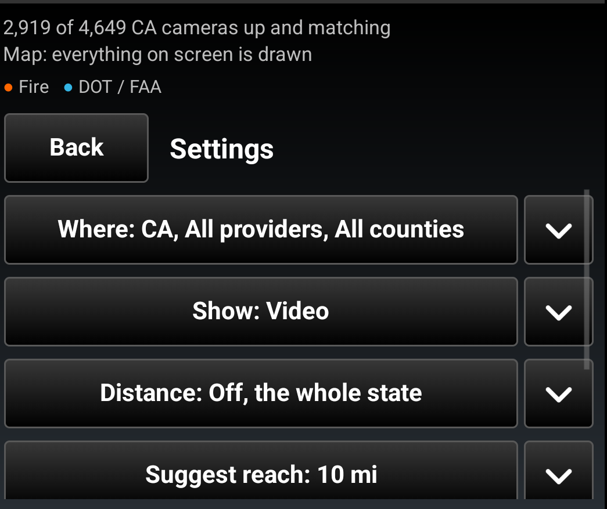

Every row reads its own value while it is closed, so the page is a summary of
how the panel is set. Tap a row to open it.

### Where

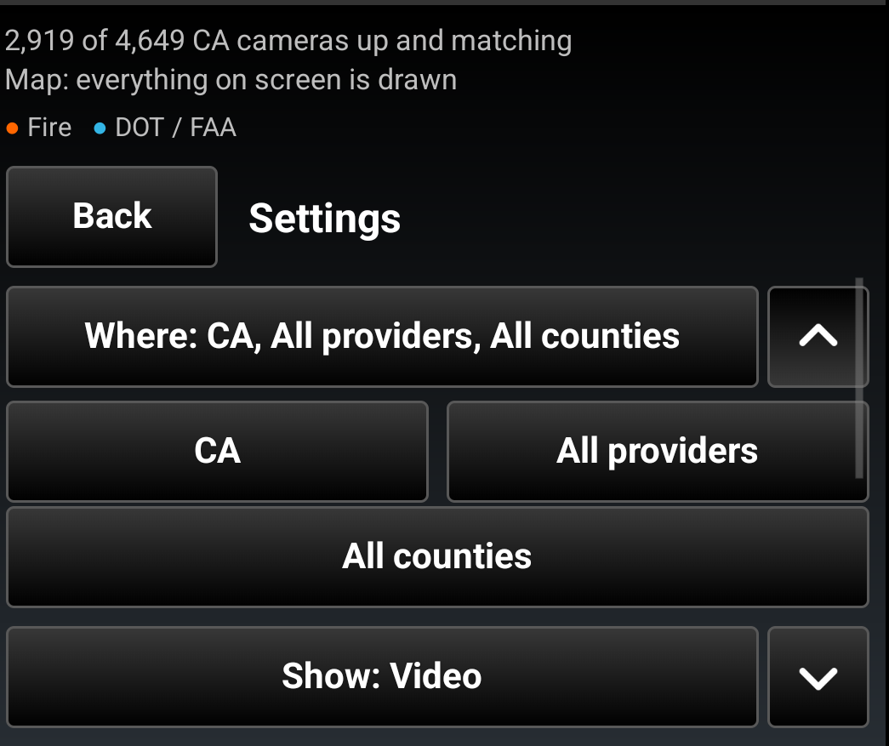

- **State** — the state or province, 54 of them.
- **Provider** — one agency within it.
- **County** — as many counties as the job covers.

Every agency says how many cameras it has **before** you pick it, so you can see
what a filter will cost rather than toggling it and watching a total move.

Counties tick on and off. They come from Census boundaries rather than from the
camera feeds, so they work on every camera in the United States, not only the
ones whose agency happened to publish a county.

### Show

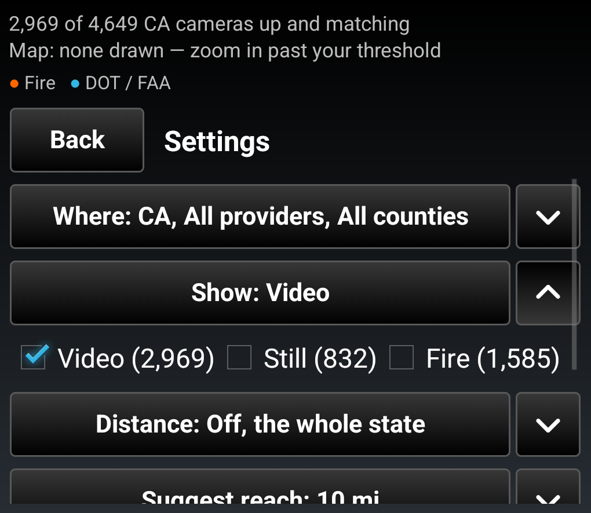

**Video**, **Still** and **Fire** each carry their own count for the state you
are in. Tick more to show more; none ticked means everything.

### Distance

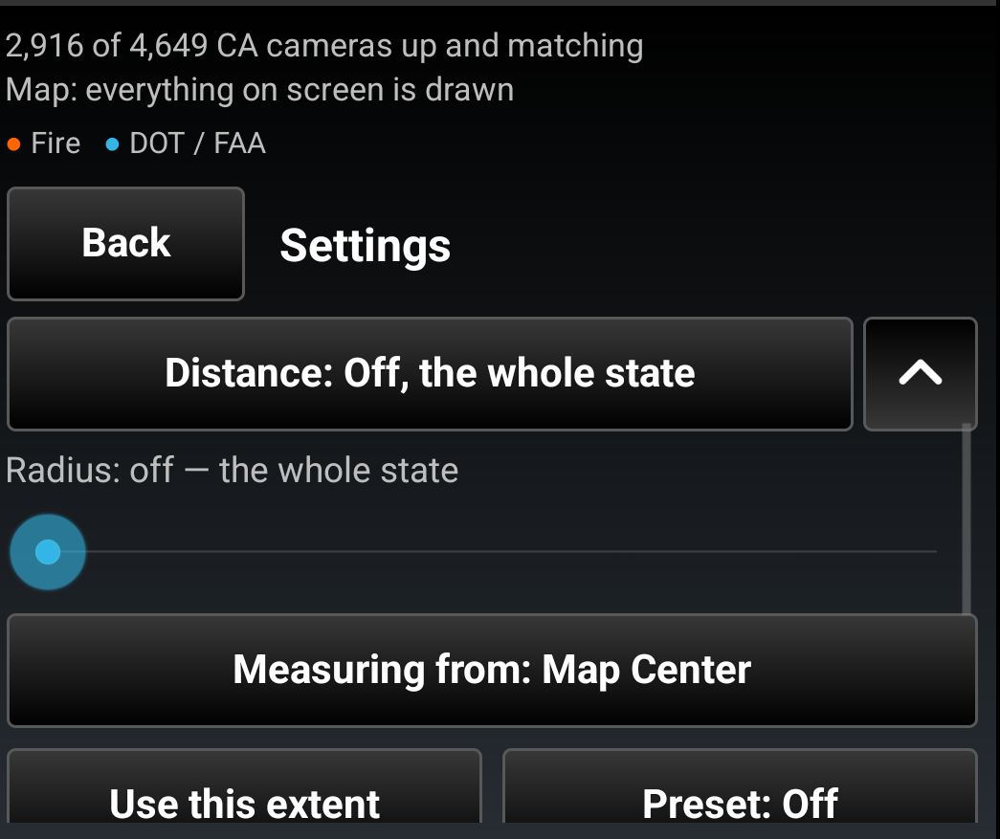

The slider runs to 50 in whatever units ATAK is set to, and the label above it
always reads the current distance and the point it is measured from.

- **Measuring from** rotates between your own position and the center of the map,
  and says which one is in force.
- **Use this extent** takes the radius from what is on screen.
- **Presets** offers Off, 2, 5, 10, 25 and 50, and names the one in force.

Measured from *My Location* the circle travels with you. Measured from *Map
Center* it follows the map. Both survive restarting ATAK.

### Suggest reach

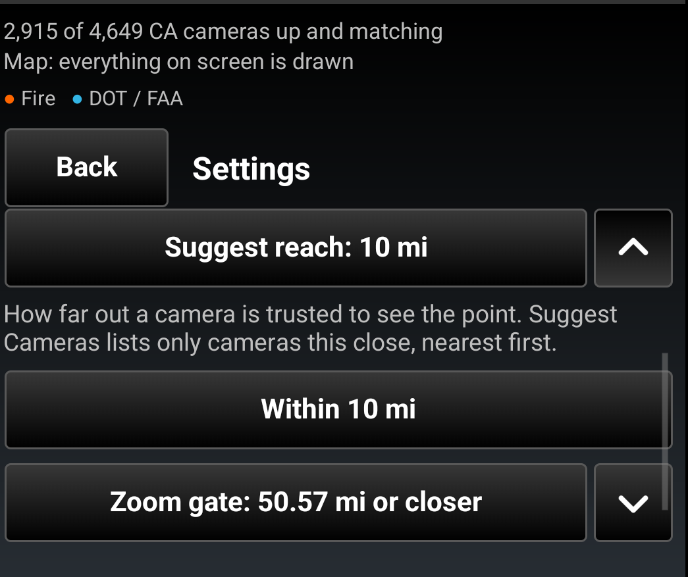

How far out a camera is trusted to see a point. Suggest Cameras lists only
cameras this close, nearest first. 10 miles to start with; the picker offers 2,
5, 10, 20 and 40 miles, or the length of the bearing line.

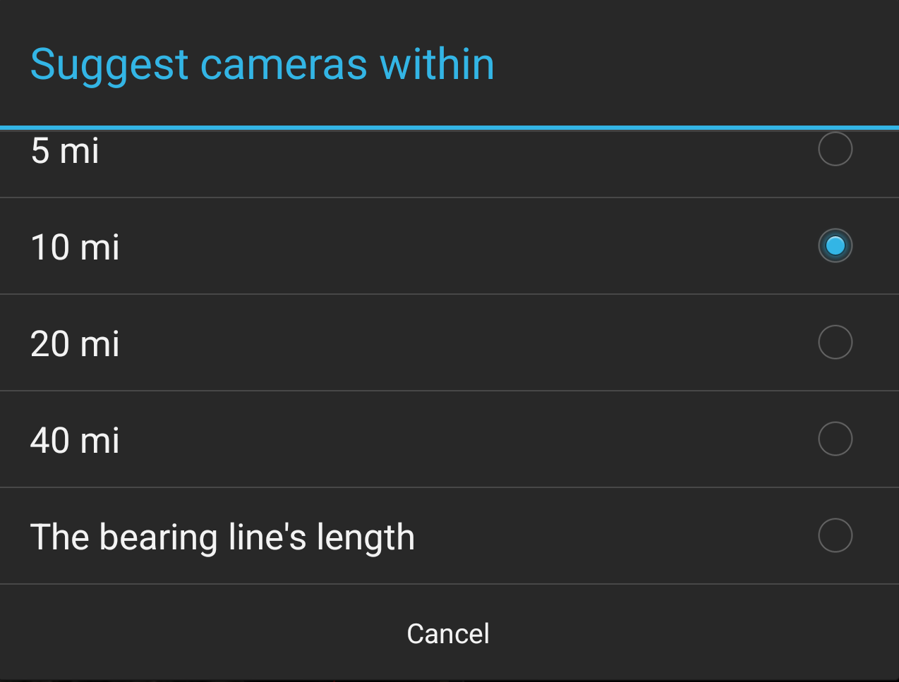

### Zoom gate

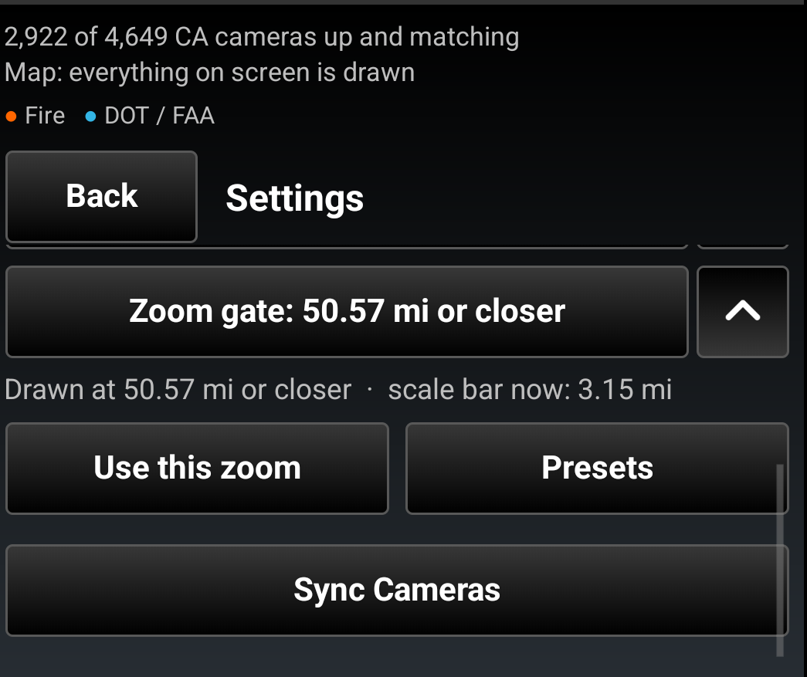

Thirty-eight thousand markers would be unreadable, so cameras draw only when you
are zoomed in past a threshold you choose. **Use this zoom** takes whatever you
are looking at now and makes it the threshold. **Presets** offers a few starting
points in plain terms.

### Sync Cameras

The catalog changes: agencies are added, cameras come and go, and stream
addresses move. **Sync Cameras** re-reads the catalog and reloads the state from
scratch, without restarting ATAK. Use it when a camera you expect is missing, or
when video that worked yesterday does not connect today.

---

## 4. Suggest Cameras

You have a point on the map and a tower with five cameras on it. Which one is
looking that way? Suggest Cameras answers it in one tap instead of turning five
bearings on and off.

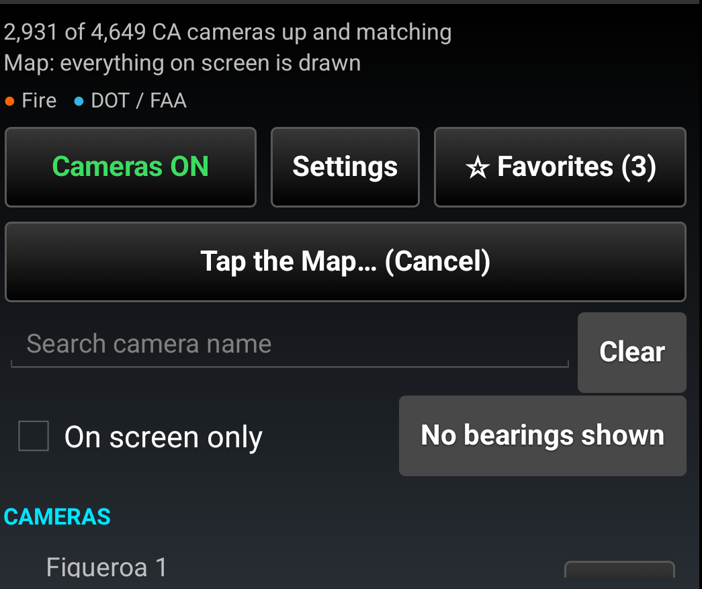

Tap **Suggest Cameras**, then tap the point on the map. A cyan marker lands
where you tapped.

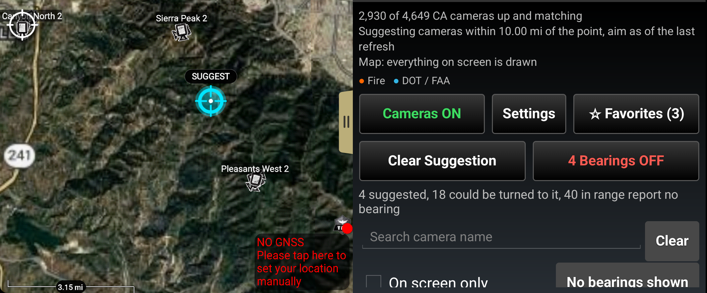

The list narrows to three groups, nearest first:

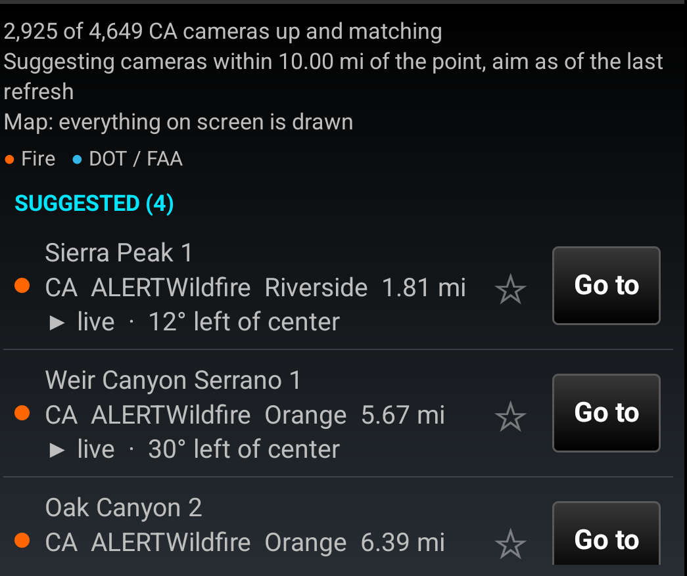

- **Suggested** — cameras whose reported aim covers the point: inside their lens
  and within 30 degrees of its center. Each row says how far the camera is from
  the point and how far off center the point sits, so you can judge the edge
  cases yourself.
- **Could be turned to it** — pan-tilt-zoom cameras within reach that are aimed
  somewhere else. Someone at the agency can swing them.
- **No bearing reported** — cameras within reach that never say where they look,
  most highway cameras among them.

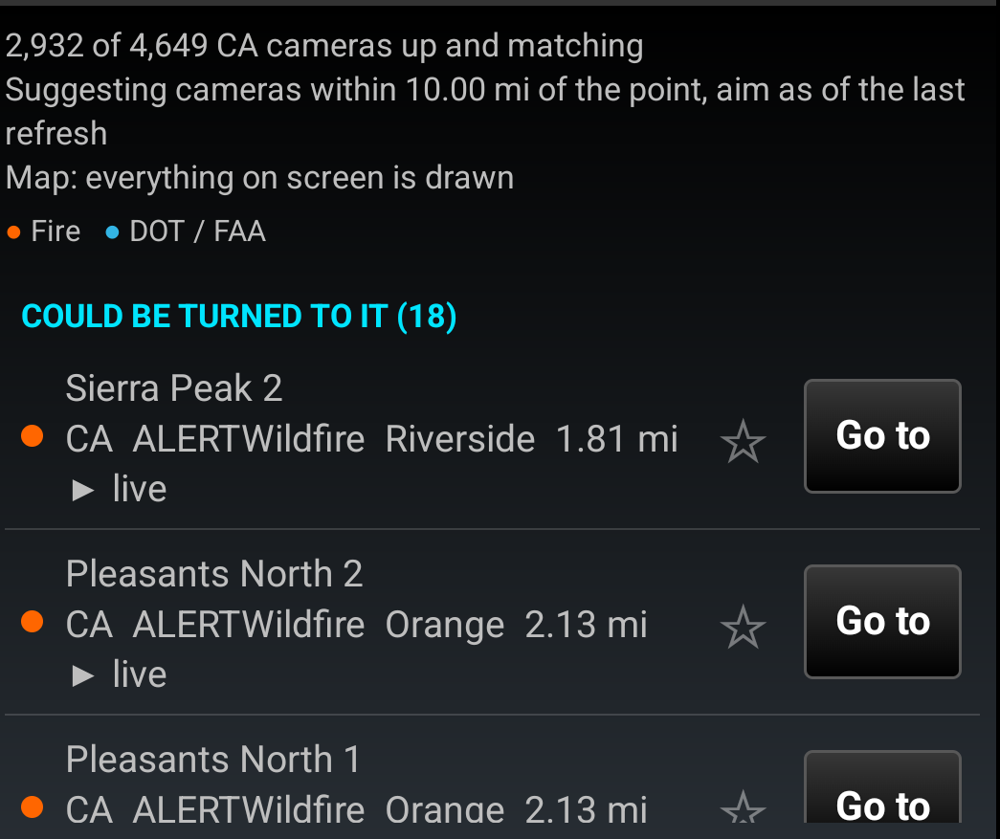

The map keeps every camera; only the list narrows.

### Bearings in one tap

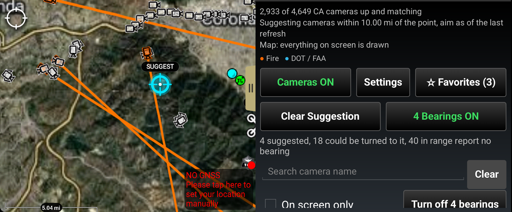

**N Bearings OFF** turns on the bearing line of every suggested camera at once
and reads **N Bearings ON** in green. Tap it again to take them down. Lines you
turned on by hand on other cameras are left alone.

### Move the point

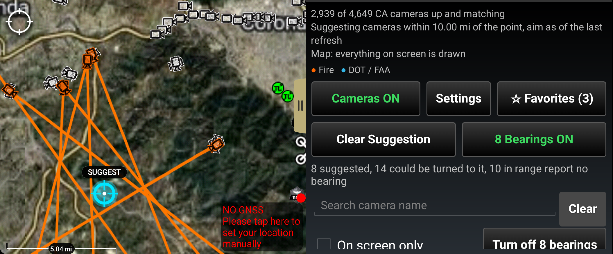

Press the marker and drag it. Where it lands, the counts recompute, and if the
bearings were on they move with it: off the cameras that dropped out, on to the
ones that came in.

**Clear Suggestion** takes the marker off the map and gives the full list back.
The point, the marker and the bearing lines all come back after restarting ATAK.

A camera's aim is as of the last catalog refresh, every few seconds, so a camera
someone just swung may still show its old direction for a moment. Tap a row to
see its picture; that is the final word on what it sees.

---

## 5. Finding one camera by name

Typing in the search box searches **every state at once**, not only the one in the
dropdown. Here "pitts" finds a wildfire lookout in California and a highway camera
in Kansas together, 1,300 miles apart.

Camera names are the agency's own — "I-40/75 @ West Hills", "Keller Peak 1" — so
a road number, a landmark or a peak name will usually find it. **Clear** lights up
only while something is in the box.

### Reading a row

Each row is one camera. The colored dot says what kind: **orange** for a wildfire
lookout, **blue** for a department of transportation or FAA camera. Under the
name are the state, the agency, the county and the distance, and a small
▶ **live** marks a camera that streams.

**Go to** moves the map to that camera. Tapping the row itself opens the camera.

### On screen only

**On screen only** limits the list to the cameras inside the current map view,
and keeps following as you pan and zoom.

---

## 6. Favorites

The star at the end of each row marks a camera as a favorite. Favorites are kept
on the device and survive restarting ATAK.

Tapping **Favorites** turns the star gold and pins them in their own section,
with the whole state still below. Favorites are not tied to a state.

**While Favorites First is on, a favorite ignores every filter** and stays on
the map whatever the panel says. The status line says so.

---

## 7. Opening a camera

Tapping a camera, in the list or on the map, opens it in a side pane so the map
stays live behind it.

The pane names the camera, then says the agency, whether it is online, whether it
steers, and the county — then shows the latest picture. **Refresh** fetches a new
frame; while one is on its way the pane says *Fetching the latest picture…*.

Pictures are current to within about a minute on most networks. Some agencies
publish on their own cycle. A few cameras publish live video and no picture at
all; those say so.

---

## 8. Live video

Where the agency publishes a stream, **Live video** plays it in ATAK's own player.
A camera that only publishes pictures says **Video (still only)**. Of the 43,000
cameras in the catalog, about 16,500 stream.

### Which cameras stream

| Streams | Stills only |
|---|---|
|  |  |
| ATAK's own camcorder | A plain camera |

---

## 9. Bearings

Cameras that report which way they are pointing can draw a bearing line on the
map, labeled with its azimuth.

**Show bearing** in a camera's pane turns it on, and the marker turns orange
while it is on. On a steerable camera the line follows the camera as it moves. A
bearing stays on when you pan away and comes back with it.

**Turn off N bearings**, beside *On screen only*, puts every line away at once.

### What the line is, and is not

The line is the **direction** the camera points, not how wide it sees. A camera's
pane reports both. Suggest Cameras uses the width; the map draws the direction,
because sixteen hundred overlapping wedges is a map you cannot read.

> On the wildfire networks the bearing runs ahead of the picture. The agency
> reports where a camera is pointing immediately and publishes its image twenty to
> thirty seconds later.

---

## 10. Drawing on the map

Past the zoom gate, the cameras draw:

If more cameras match than can be drawn legibly, the status line says how many
were left off and to zoom in. It will not quietly show you part of the picture.

**Cameras OFF** takes every camera off the map and changes nothing else: the
filters, the list and any bearings you asked for stay as they are, so ON puts
back exactly what was there. The switch is remembered across restarts.

---

## 11. Where the cameras come from

Cam Depot does not talk to twenty agencies from your device. One service collects
from them, checks what it collected, and publishes a single catalog that every
device reads.

**Camera pictures and video are fetched straight from the agency by your device.**
They do not travel through anything of ours.

---

## 12. In the plugin

The same guide ships inside the plugin as a PDF. In ATAK go to **Settings → Tool
Preferences → Cam Depot → Plugin Documentation**.

---

## Questions and problems

Issues and questions: https://github.com/takwerx/cam-depot/issues
