# Atmosphere for ATAK — User Guide

**Version 0.19 · takwerx**

**Download Atmosphere 0.19** (pick the one matching your ATAK-CIV version, sideload, then load it in ATAK's Plugins manager):

- **ATAK-CIV 5.6:** https://github.com/takwerx/atmosphere/releases/download/v0.19/ATAK-Plugin-Atmosphere-0.19--5.6.0-civ-release.apk
- **ATAK-CIV 5.7:** https://github.com/takwerx/atmosphere/releases/download/v0.19/ATAK-Plugin-Atmosphere-0.19--5.7.0-civ-release.apk
- **ATAK-CIV 5.8:** https://github.com/takwerx/atmosphere/releases/download/v0.19/ATAK-Plugin-Atmosphere-0.19--5.8.0-civ-release.apk

All releases: https://github.com/takwerx/atmosphere/releases

Atmosphere is the weather on the ATAK map for fire and hazmat crews: the
forecast at a point, the readings from the weather stations, river gauges and
buoys around you, and the pictures the weather services publish — radar,
satellite, wind, rain, smoke, air quality, lightning, fire and flood outlooks,
the Santa Ana wildfire threat, power shutoffs, flooding, waves, the sea and
snow — and what happened on the ground: storm reports, surveyed tornado paths,
post-fire debris-flow hazard and earthquakes — each one a layer you switch on
when you need it.

Everything it shows is read by your device from public services and stays on
your device. Nothing is published to a server or to anyone else's map. The
forecast asks the National Weather Service for the point you are reading; every
map layer asks you once, naming its server, before it talks to the network.

Warnings, watches and advisories are not here on purpose: they are the
[IPAWS Alerts](https://github.com/takwerx/ipaws-alerts) plugin's job, and the
two are meant to run side by side. The one exception is fire: a fire weather
zone under a Red Flag Warning or a Fire Weather Watch is shaded, and the
Fire Weather Zones page lists them.

---

## 1. Before you start

- Published builds exist for **ATAK-CIV 5.6, 5.7 and 5.8**. Install the one that
  matches your ATAK exactly; a build for another version will not load.
- The phone needs a network path to the weather services; each map layer names
  its server when it first asks to be allowed. A reading that has been fetched stays
  readable when the network drops, with its age on it.
- The forecast needs nothing set up: it reads from the National Weather Service
  (NWS) as soon as Atmosphere opens, in US units. Outside the US, open
  **Forecast settings** and tap **Forecast from Open-Meteo**.

## 2. The pane

Open Atmosphere from the ATAK toolbar, or from Tools if it is not on the bar.
The pane opens at half width. The top row is the same on every page:

- **My position**, **Map center** and **Pick a point** choose the point every
  reading is for; the one in use is green. Map center follows the map: the
  forecast and the fire weather zone are read again when the map stops. The
  Weather Stations, River Gauges and Buoys lists are measured from this point
  too, nearest first, and say which point in their status line.
- The star is **Favorites**: places kept by name.
- **Units** switches every number between US, metric and aviation units.
- **Full size** makes the pane full width and back; at full size every button
  has its name under it.
- The stacked sheets are **Layers**: straight to the Layers page from any page.
  It is green while Layers is showing.
- The arrows step through the pages; the page name between them opens a list of
  all eleven.

 

The eleven pages are **Forecast**, the readout for a point; **Layers**, every map
layer with its switch and settings; **Spot Weather Forecast**, the open spot
forecast requests; **Fire Weather Zones**, the planning forecast for a zone;
**SAWTI**, the Santa Ana Wildfire Threat Index; **Fire Danger**, an area's
Energy Release Component and its GACC's chart; **Weather Stations**, **River
Gauges** and **Buoys**, the ones around you as lists; **Storm Reports**; and
**Rain Gauges**. Back closes the pane, or narrows a full-size one first.

A page whose data is a map layer starts with that layer's switch, the same
switch as on the Layers page: turn the layer on or off from either and both
say so.

## 3. The forecast

The first page is the readout for one point: your position, the map center, a
point you tap on the map, or a favorite. The top line names the point and how
old the reading is.

- **Now**: temperature, humidity, the 20-foot wind and where it is from, gusts,
  mixing height, transport wind, wet bulb globe temperature and the chance of
  rain; under them the sky cover, sunrise, sunset and the moon. An element the
  forecast office does not issue says so.
- **Next hours**: the next day and a half as a line, one value at a time; the
  buttons under it pick which. **Show hourly table** opens the whole table.
- **Next days**: each day's high and low, lowest humidity, strongest wind and
  gust, and highest chance of rain.

 

**Refresh** at the top of this page reads the forecast again. **Forecast
settings** beside it picks where the forecast comes from, **NWS (United
States)** or **Open-Meteo** for anywhere else, with one tap, and **What to
show** picks the readings. The point is sent rounded to about 100 m.
**Favorites** keeps places by name.

 

**Synopsis.** Under the days, the forecaster's own words: the Area Forecast
Discussion for the office covering the point, its Synopsis open, and the other
sections the office writes (Short Term, Long Term, Discussion, Aviation, Marine,
Fire Weather) each behind a button that opens it in place. It follows the point
in the top row, so Map center in another office's area brings that office's
discussion. The watches and warnings list stays with IPAWS.

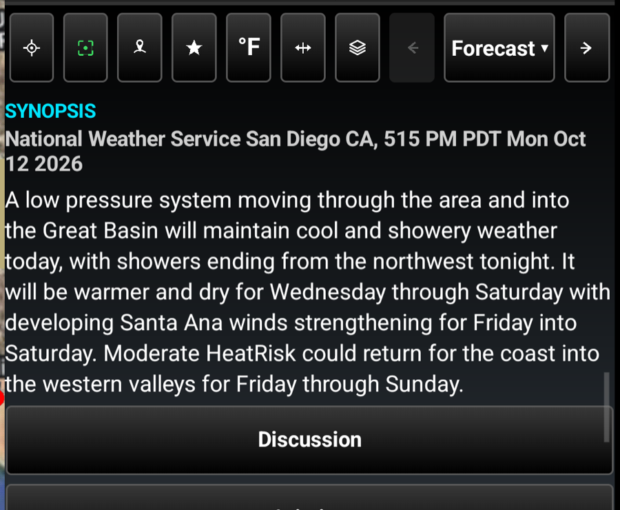

## 4. The layers

The second page lists every layer under a heading for what it is about; tap a
heading to fold its group to one line (it turns green with a count when a layer
under it is on): **Spot
Weather Forecast** and **Weather Stations** at the top, then **Wind**, **Fire**, **Rain and
rivers**, **Ocean** and **Snow**. Each row is a switch that shows its state —
green ON, red OFF — with the layer's icon beside it. **All on** and **All off**
switch every allowed layer at once.

A layer that is ON grows an arrow at the end of its row; tap it for the layer's
settings, its map key, and a status line that says what is on the map and what
is not — "zoom in to see", "drawn for the middle of the map", "no storms right
now".

The first time a layer is switched on it asks once, naming the server it will
talk to and what is sent: the area of the map, never your position, unless the
layer says so. **Allow** remembers the answer.

Tap anything Atmosphere draws and it opens straight away: a fire weather zone,
spot request, gauge or buoy opens its page, anything else its details. A Fire
Danger area opens from its name, because the areas cover the whole map. There
is no radial menu on Atmosphere's items; bloodhound and the rest are ATAK's own
tools.

Labels stay level when you turn the map, so they read the right way up at any
heading; a station's wind barb turns with the map, because it is a direction.

Every layer that draws on the map is a row inside one **Atmosphere** row in
ATAK's Overlay Manager, each with its own icon, where it can be hidden without
opening the plugin.

 

| Group | Layer | What it draws |
|---|---|---|
| | Spot Weather Forecast | Every open spot forecast request, with the office's forecast behind a tap |
| | Weather Stations | The stations around you, wind barb and readings, colored against the Red Flag criteria for their zone; in California, the utilities' stations too |
| Wind | Radar | The NWS radar mosaics over the US, Environment Canada's over Canada, and RainViewer's composite of the world's public radars everywhere else, whichever the map is over, with a time scrubber, Play to loop the last two hours and see which way the cells move, and a transparency slider |
| Wind | Satellite | The newest GOES picture, infrared (day and night) or visible; reaches the open ocean where no radar does |
| Wind | Rain | The model's rain rate, light to violent, hour by hour for five days with the rate "Here"; a forecast, not radar |
| Wind | Wind | The forecast wind as moving streaks colored by speed, or as a heat map under them in the same colors, with a time scrubber, heights to the jet stream, and the wind "Here". Runs together with Radar; the heat map and Radar take turns |
| Storms | Storm Reports | Every report the NWS offices logged in the last 24, 48 or 72 hours: tornado, wind, hail, flood, rain, snow and ice, landslide; the type and size in the pill, the remarks behind a tap |
| Storms | Tornado Paths | The tracks NWS survey teams walked in the last 2 days, 7 days, 30 days or year, each line in its EF rating's color with a pill at the touchdown; length, width, peak wind, injuries, deaths and the survey behind a tap |
| Fire | Fire Weather Outlook | Elevated, critical and extreme areas and dry thunderstorms, Day 1, 2, 3 or all; from Day 3 as a chance of critical |
| Fire | Fire Weather Zones | The NWS fire weather zones with their numbers, shaded under a Red Flag Warning or a Fire Weather Watch; the zone's planning forecast behind a tap |
| Fire | SAWTI | The Forest Service's Santa Ana Wildfire Threat Index for four Southern California zones, colored by level for each of four days; the SAWTI page behind a tap |
| Fire | Fire Danger | Every Predictive Service Area in the lower 48 shaded by its Energy Release Component, observed yesterday or forecast today; the GACC's ERC chart behind a tap on an area's name |
| Fire | Fuel Moisture | Every fuel sampling site in the state under the map, a dot colored by its newest sample's moisture (critical, high, moderate, low, on the live-fuel or the timelag class's own breaks) with the fuel and percent in the pill; every fuel sampled there, with dates, behind a tap; 30 days, 90 days or a year back; live fuels, dead fuels or both |
| Fire | Lightning | NOAA's lightning strike density, the newest 15 minutes, in five bands from under 1 to over 150 strikes in a 5-mile square |
| Fire | PSPS | California's Public Safety Power Shutoffs: counties warned, circuits watched, areas shut off, by utility |
| Fire | Smoke | Forecast smoke at the ground or through the whole sky, with the amount "Here"; the same forecast at every zoom, so the smoke keeps its shape as you zoom |
| Fire | Air Quality | The EPA's air quality areas and the index "Here" |
| Rain and rivers | Flash Flood Outlook | Excessive rainfall areas for three days, marginal to high |
| Rain and rivers | River Gauges | Gauges colored by flood category; stage, flow and hydrograph behind a tap |
| Rain and rivers | Flooded Ground | Where the river model puts water over the banks, now or at the worst of the next 5 days (experimental) |
| Rain and rivers | Rain Totals | The rain that fell, as a picture: the NWS radar estimate for the last hour to 3 days, the gauge-corrected analysis for 7 or 30 days, since Oct 1 or Jan 1, or the radar estimate of the hours before a date and time you pick; in the NWS colors, with a transparency slider |
| Rain and rivers | Rain Gauges | Measured rain gauges around the map (USGS, airports, NWS observers, county flood control, RAWS) with their total for the time you pick, from the last 24 hours to since Jan 1, one day, or the hours before a date and time; inches in the pill, in the Rain Totals colors |
| Rain and rivers | Streams Running High | Stream stretches over their high-water mark, colored by how rare the flow is; the numbers behind a tap |
| Rain and rivers | Debris Flow | The USGS post-fire assessments: every fire of the last three years marked; a fire's page shows or hides its perimeter and stream basins, filled Low, Moderate or High for a 15-minute burst of rain, with likelihood and volume behind a tap |
| Ocean | Buoys | Buoys and coastal stations, readings colored by sea state; tides, currents and the marine forecast behind a tap |
| Ocean | Waves | The wave forecast: seas colored by state, the swell as moving crests, five days on the time strip, with the seas "Here" |
| Ocean | Beach Forecast | Beach areas colored by rip current risk |
| Ocean | Sea Temperature | Sea surface temperature as a picture |
| Ocean | Hurricanes | Active storms: track, cone, wind fields, advisory; a storm NHC no longer forecasts shows only where it is |
| Snow | Avalanche | Forecast zones by danger rating, travel advice behind a tap |
| Snow | Snow Stations | Mountain snow stations: depth, water equivalent, temperature |
| Snow | Snow Depth | The daily snow analysis as a picture |

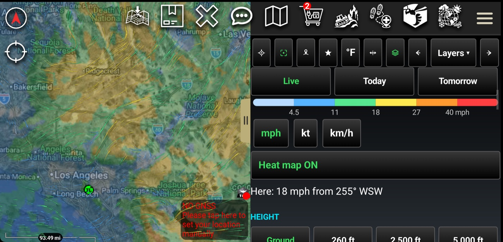 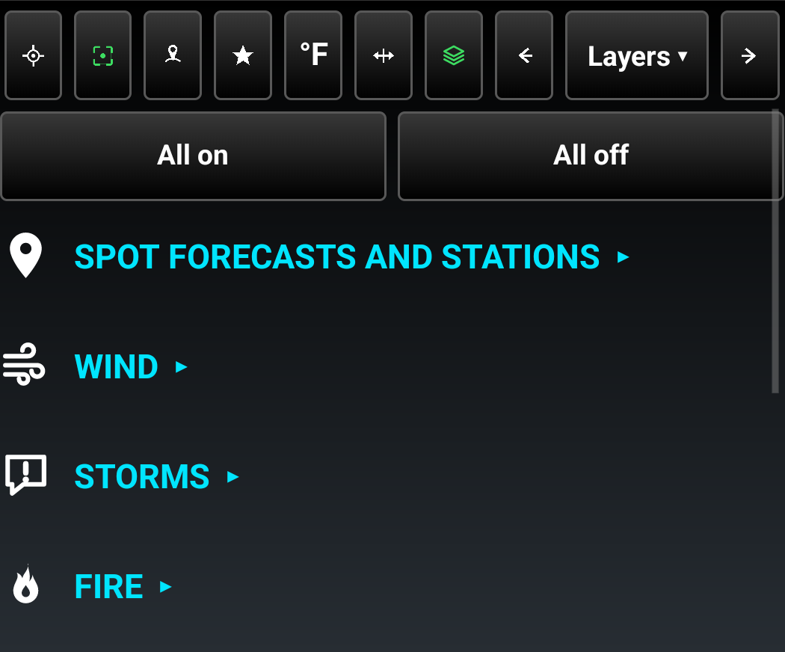

## 5. What the layers look like

<table>
<tr><td> Radar over the Northeast</td>
<td> Radar over Mexico and Central America, from RainViewer</td></tr>
<tr><td> Satellite, infrared: a hurricane's eye at sea</td>
<td> Wind around the same hurricane</td></tr>
<tr><td> Rain, the model's forecast, where no radar reaches</td>
<td> Fire weather outlook, Day 2 Elevated</td></tr>
<tr><td> Smoke at the ground</td>
<td> Flash flood outlook, Day 2</td></tr>
<tr><td> Flooded ground along a river at major flood</td>
<td> Streams running high on the same river</td></tr>
<tr><td> Waves: sea state and swell</td>
<td> Hurricanes: track and cone</td></tr>
<tr><td> Beach forecast: rip current risk</td>
<td> Weather stations with wind and humidity</td></tr>
</table>

## 6. Weather stations, river gauges and buoys as lists

The **Weather Stations**, **River Gauges** and **Buoys** pages list what their layers draw,
nearest first from your position or the map center, out to the distance you
pick. The filters at the top say what each will show, with a count, before you
tap. A star keeps one as a favorite, and a favorite stays on the map and in the
list however far away you go. **Go to** frames one on the map; tapping a row
opens the whole record.

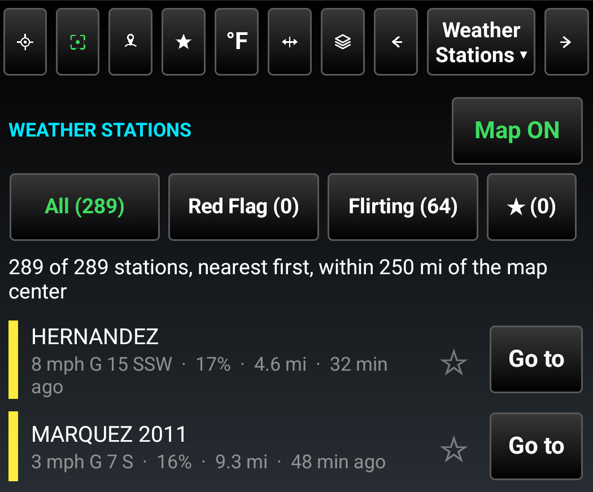 

- A station's record: every reading, its fire weather zone and the Red Flag
  criteria for it, and the station's own page.
- A gauge's record: stage and flow now, the flood stages, and the observed and
  forecast hydrograph for the last day to the last month.
- A buoy's record: its readings and the sea state they mean, the nearest tide
  station's highs and lows, the nearest current station's ebb and flood, and
  the coastal or offshore waters forecast for the water it sits in.

 

Two settings per layer decide when things draw: at this zoom or closer for the
markers, and for their readings. **Use this zoom** takes what the scale bar
reads now; **Always** never hides them.

**Utility stations.** In California, **Utility Stations ON** under the Weather
Stations arrow adds the stations SCE, SDG&E, PG&E and HPWREN run, from Cal OES.
They draw on a slate disc beside the blue fire weather stations, their names
start with the utility's, and they come in at their own zoom, 5 miles on the
scale bar by default, because there are hundreds of them: 472 within 50 miles
of Vista. A utility averages its wind over a minute or two, not ten as a fire
weather station does, so it reads higher than one beside it, and it has no fuel
moisture; its record says so at the top. They are counted on their own line
under the switch, with how many are at criteria. A station that is also a fire
weather station is drawn once, as the fire weather station.

 

 

## 7. Fire weather zones

**Fire Weather Zones** draws the National Weather Service's fire weather zones
in the map view: purple outlines, each with its zone number, a starred zone in
yellow, a zone under a Red Flag Warning filled pink and one under a Fire Weather
Watch beige. Tap a zone for its forecast. Two zoom settings under the layer's
arrow decide when the zones and their numbers draw; a view wider than a few
states says to zoom in.

 

The **Fire Weather Zones** page shows the zone the point you are reading is in,
**Red Flag Warning** and **Fire Weather Watch** with how many zones are under
each anywhere in the country, a search by zone number (CAZ548, CA548 or 548)
or by name, and your starred zones. Tap one for the office's Fire Weather
Planning Forecast for that zone, as the office wrote it: western offices write
it by period, eastern ones as a table; slide sideways for a wide line. The star
keeps the zone on the page and yellow on the map. **Show the office
discussion** opens the office's discussion for the day under it, and a
forecast more than a day old says so.

  

Under the office and issue time, **Fire danger (ERC)** gives the Energy
Release Component for the area the zone is in: its name, yesterday's observed
value and today's forecast with their percentiles and which way they are going,
and the Burning Index. ERC is published for these larger areas, Predictive
Service Areas, not for each zone. **ERC chart and details** opens the area on
the Fire Danger page.

## 8. SAWTI, Fire Danger, Fuel Moisture, Lightning and PSPS

**SAWTI** draws the US Forest Service's Santa Ana Wildfire Threat Index for its
four Southern California zones: LA-Ventura, Orange-Inland Empire, San Diego and
Santa Barbara, where it rates Sundowner winds. It rates how hard a fire would be
to fight if one started during an offshore wind: No Rating, Marginal, Moderate,
High or Extreme. A rated zone is filled in its level's color, with its label in
the same color; a No Rating zone is a blue outline. Each label starts with
SAWTI, "SAWTI-San Diego: No Rating", so it is not taken for another layer's
area. The date buttons pick one of the four days the Forest Service shows. Tap
a zone to open its page.

 

The **SAWTI** page is the Forest Service site's forecast page. It opens on the
zone the point you are reading is in, and the zone button picks another. Each
day button shows that day's level. Under the level are the site's three gauges,
**Threat Level**, **Wind Strength** (weak to strong) and **Fuel Moisture**
(moist to dry), then the forecaster's **Event Description** and **Recommended
Actions**, with the county links the site gives for the zone. **All Zones**
puts every zone and day side by side; tap a square for that zone and day. The
issue time is under it, and an issue more than a day old says so. When the wind
and fuel numbers cannot be had, the gauges say *Not available* and the page asks
again the next time you look.

The page and the map show the same day: a day picked here is the day the map
draws, a day picked on the Layers page shows here, and picking a day here turns
the SAWTI layer on. While the page is open, the zone it shows has a white
outline on the map, so you can find it among the others; leave the page and the
outline goes.

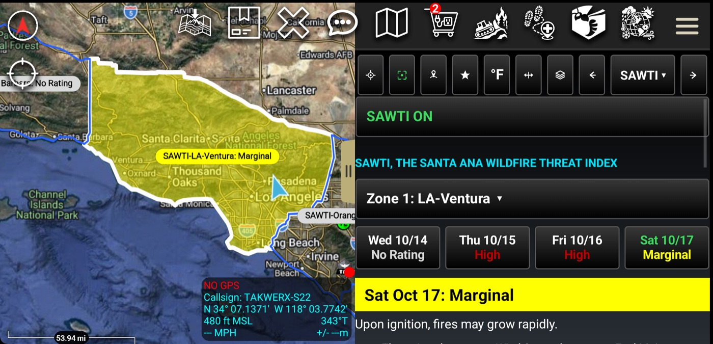

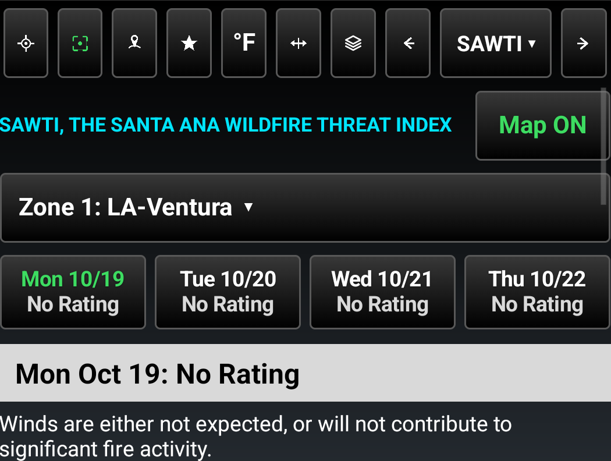 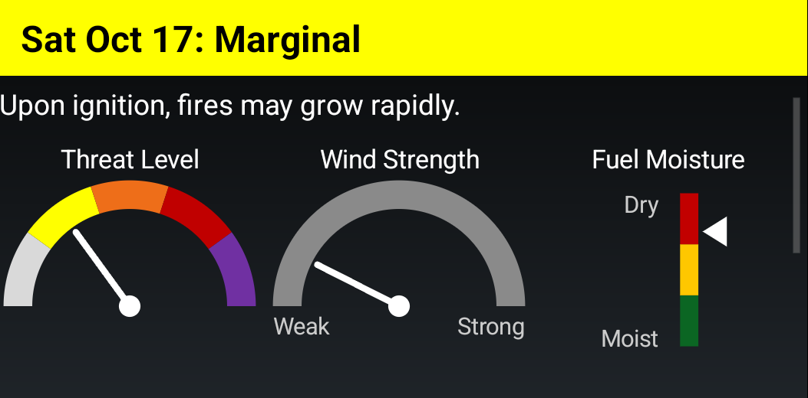

 

**Fire Danger** shades every Predictive Service Area in the lower 48 by its
Energy Release Component (ERC), the fire danger index each GACC charts on its
fuels page: green below the 60th percentile, then light green, cream, orange
from the 90th, red from the 97th and dark red above the 99.5th. **Observed**
is yesterday's value, **Forecast** today's; the Forest Service rebuilds them
from FEMS every morning, and an area's value is the average of its key fire
weather stations. Percentiles are of every day of the year, 2005 to 2022. Each
area's name and number show from a scale bar of about 75 miles in; tap the name
for the area. Alaska rates fire danger on the Canadian system and is not
shaded.

 

The area opens on the **Fire Danger** page at full size: its ERC and Burning
Index, observed and forecast, and its GACC's own ERC chart, with this year's
line, the average, the record and the forecast tail. **Tap the chart to
enlarge** puts it on the whole screen: pinch to zoom, drag to move, double-tap
to zoom in or back out. Some GACCs draw their chart's percentile bands for the
fire season rather than the whole year, so a band there need not match the
percentile above it. The Southern and Eastern Areas no longer publish ERC
charts; their areas show the numbers only.

 

**Fuel Moisture** draws the fuel samples crews cut and weigh every week or
two: every sampling site of the National Fuel Moisture Database in the state
under the map center, a dot colored by its newest live fuel's moisture and the
fuel and percent in the pill, `Chamise 58%`. Live fuel moisture is water as a
percent of the plant's dry weight, so it runs past 100; the colors are the
chaparral thresholds, 60% and under critical (red), 61 to 79 high (orange),
80 to 99 moderate (yellow), 100 and over low (green). The dead fuel classes
are rated on their own breaks, the conservative figures the Texas A&M Forest
Service pocket cards and the Oklahoma Mesonet burn window publish, since no
national table exists: 1 and 10 hour fuels 6 / 9 / 15, 100 hour 10 / 13 / 18,
1000 hour 13 / 16 / 22, each the top of critical, high and moderate. Duff has
no published scale and draws grey. The first row picks
how old a sample may be, **30 days**, **90 days** or **1 year**; **Show** picks
**Live fuels**, **Dead fuels** or **Both**, the pill always the newest of
that kind. The status line counts the sites and names the driest live fuel in
the state. Tap a dot for every fuel the site samples, each with its last value,
date and the years it has been sampled. Moving the map into another state asks
for that state. The database is the US Forest Service's; the samples reach the
plugin through San Jose State University's fuel moisture portal.

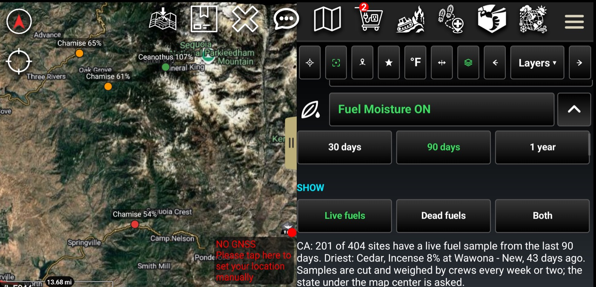

**Lightning** draws NOAA's lightning strike density: how many strikes the
ground networks counted in each 5-mile square in 15 minutes, from yellow (under
1) to deep purple (over 150). It counts ground strikes and some cloud flashes.
A new frame comes every 15 minutes and arrives 10 to 25 minutes after the
strikes; the line under the switch says which 15 minutes and how old. It shows
which storms are making lightning and whether they are building. It is not a
reason to call it safe to be outside.

 

**PSPS** draws California's Public Safety Power Shutoffs: a county a utility
has warned Cal OES may have a shutoff in amber, a circuit SCE or SDG&E is
watching for one in orange (**PSPS Watch**), and the areas a utility has shut
off in red, each named by its utility, such as "PG&E - PSPS". Tap one for its
circuit, customers out, the shutoff window and when power is expected back.
From about 10 miles in on the scale bar each area has its own label; farther
out, nearby areas share one, "SCE - PSPS (23)", and past 150 miles the colors
stand alone. The line under the switch counts what is warned, watched and shut
off, by utility, and when it was updated; a source that goes quiet for 45
minutes is said to be unknown, never none. It comes from Cal OES (PG&E and the
warned counties), Southern California Edison and San Diego Gas & Electric,
through takwerx's server. It does not cover PacifiCorp, Liberty, Bear Valley or
any other state: ask the utility.

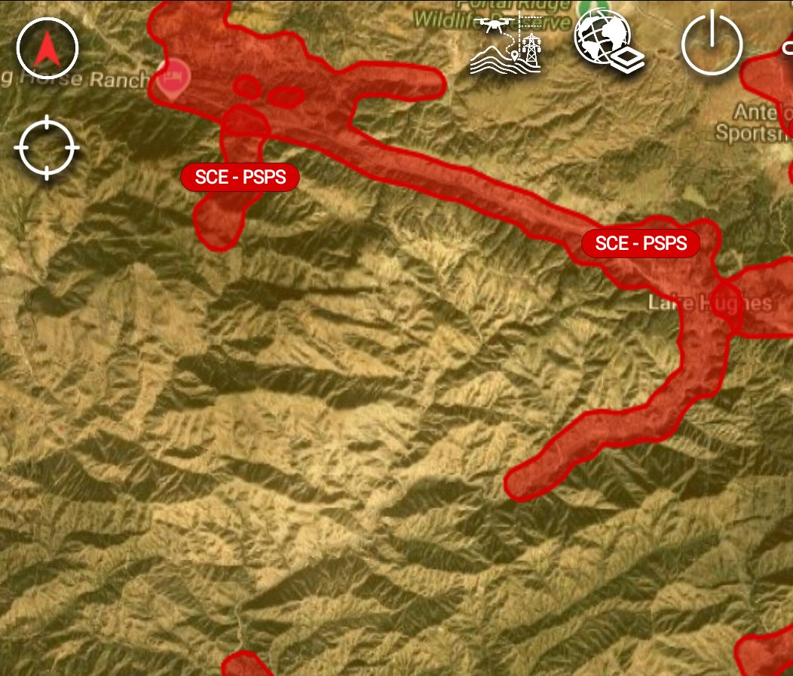 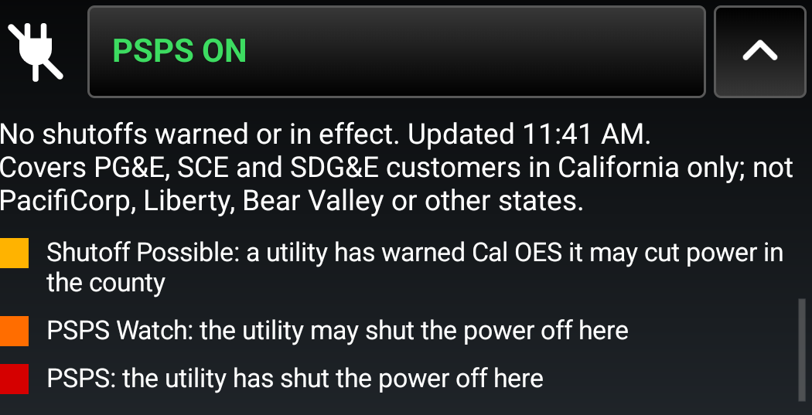

## 9. Storm Reports, Tornado Paths, Debris Flow and Earthquakes

These four are what happened, not what is forecast. Each is a national or
worldwide file from the agency, so none of them sends your position; Debris
Flow sends the area the map shows, because the basins are too many to fetch
whole.

**Storm Reports** draws every report the NWS offices logged in the last three
days: a dot in its family's color (tornado red, wind orange, hail green, flood
blue, rain teal, snow and ice violet, landslide and debris flow brown, other
grey) with the NWS type and size in the pill, `Hail 1.75 in`, `Gust 66 mph`,
`Tornado`. The row under the switch picks 24, 48 or 72 hours. Tap a dot for
where, when, the office and its remarks. They are preliminary, as spotters
and the public told the offices; the surveyed tornado paths are the next
layer.

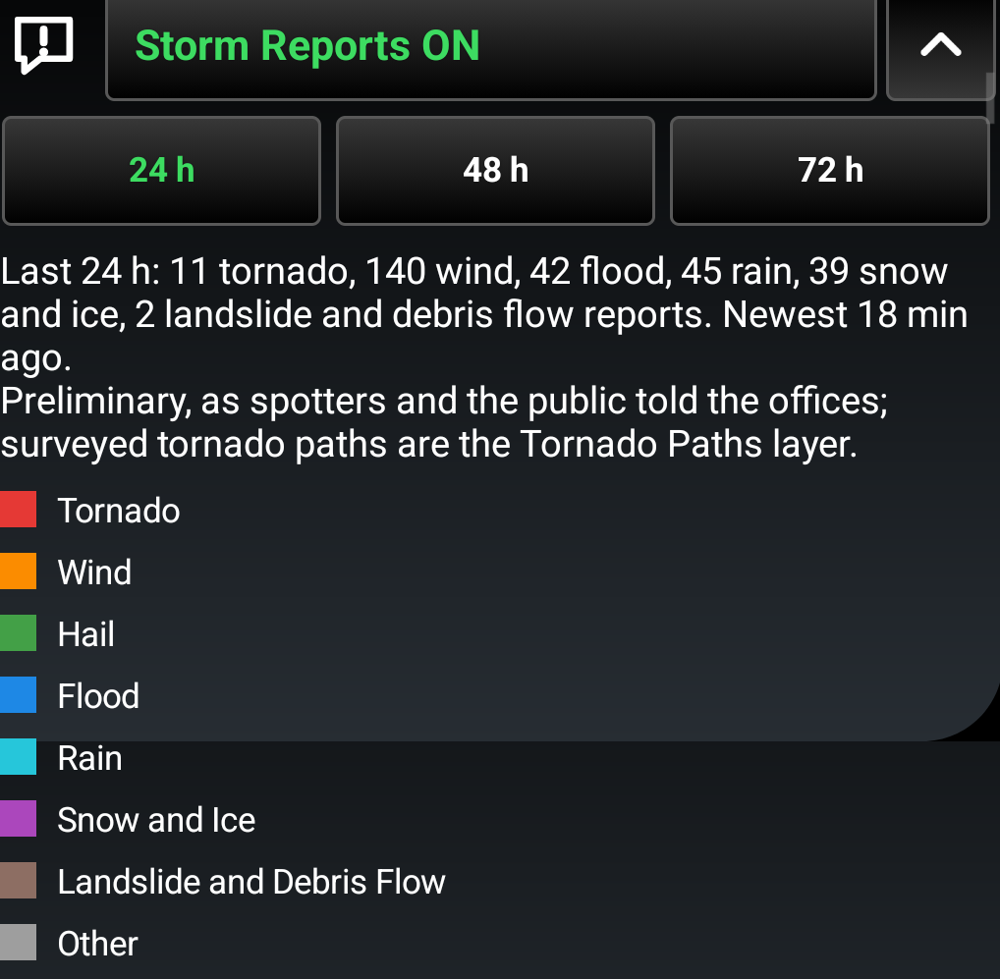 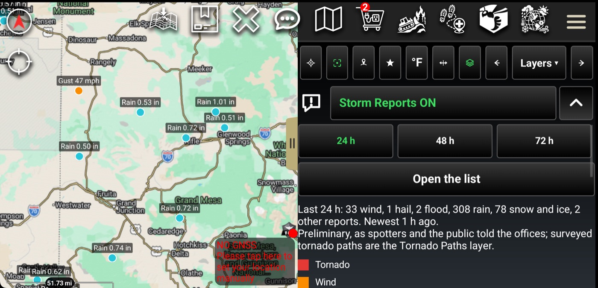

**The Storm Reports page** lists the same reports, and the tornado paths with
them, under one row of buttons. The first reads where the list looks and how
many it holds, and opens the choices beneath it: **US**, **Near** the point in
the pane's top row (your position, the map center or a picked point), on the
**Map** as it sits, re-read whenever the map settles, or by **State**. The next
flips between **Newest** and **Closest** first. **All Types** is a type picker
of switches, any mix of the eight families and **Tornado**, which covers the
dots and the paths; what you tick is what the map draws. The last steps through
the window: **24 h**, **48 h**, **72 h**. A row flies the map to the report and
opens its details in one tap. **Open the list** under the layer's switch jumps
to the page.

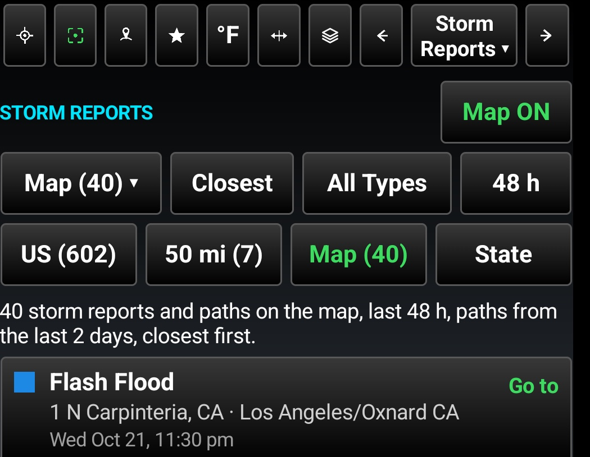 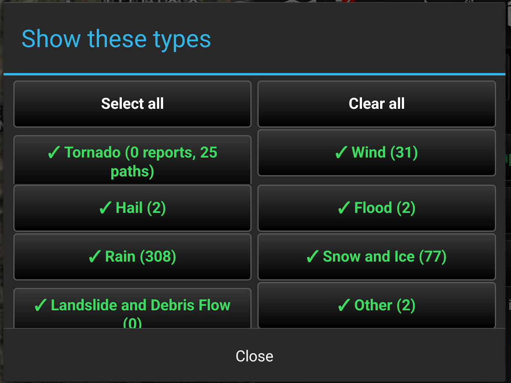

**Tornado Paths** draws the track a survey team walked after a tornado, as a
line in the Damage Assessment Toolkit's color for its EF rating, from EF0 aqua
to EF5 purple, EFU grey for a tornado with nothing to rate, with a level pill
at the touchdown naming the rating and the event. The row picks the last 2
days, 7 days, 30 days or year. Tap a line for the rating, the office, when it
was on the ground and for how long, the path's length and width, the peak wind
the damage implies, injuries and deaths, and the survey team's words. A path
appears a day or more after the storm, once the office has walked it, and is
preliminary until the office finalizes it.

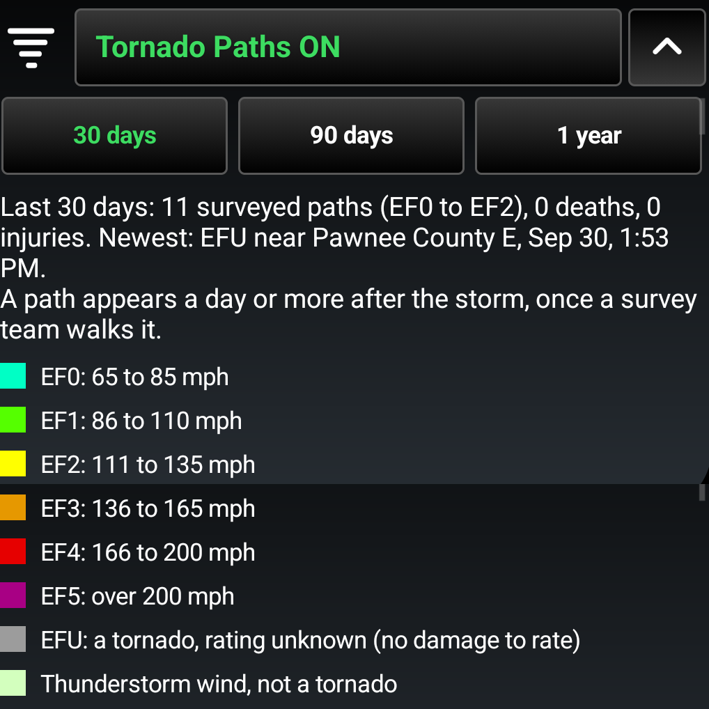 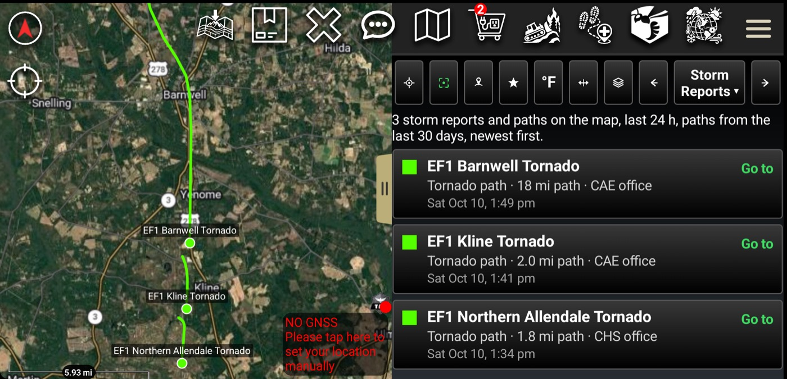

**Debris Flow** sits in the Rain and rivers group because a debris flow is a
flood of rock and mud, and the trigger is a burst of rain over a burn. It
draws every fire the USGS has assessed in the last three years as a marker
with the fire's name and year, and that is all it draws on its own. Tap a
marker for the fire's page, and **Show the area** on it brings the map to that
burn and draws that fire's perimeter and each stream basin, filled in USGS's
own colors: Low
yellow, Moderate orange, High red, for one 15-minute burst of rain at the rate
the USGS set for that fire (24 mm/h, about an inch an hour, for most). Tap a
basin for the likelihood of a debris flow, the volume it would carry, the
storm it is for and the fire; tap a fire marker for when it burned, when it was
assessed and the USGS record. **Hide the area** on the same page takes the
basins off again; more than one fire can be shown at once, and the set is
remembered. The status line names the fires shown and counts their basins by
hazard. A burn stays hazardous for two to five years, until the slopes grow
back.

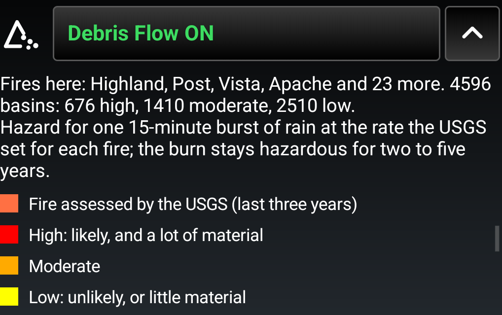 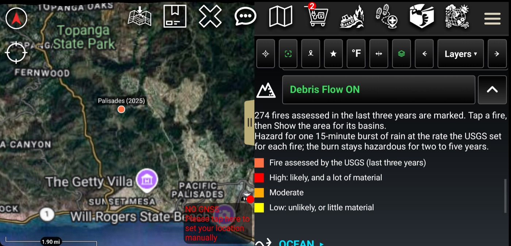

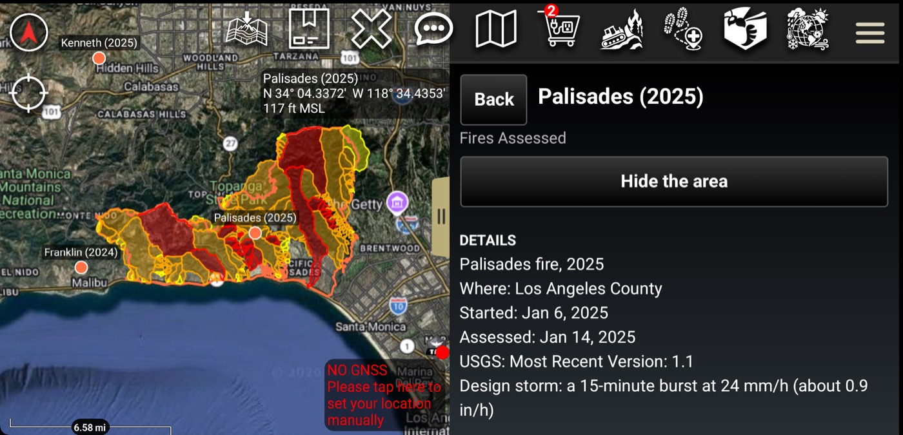 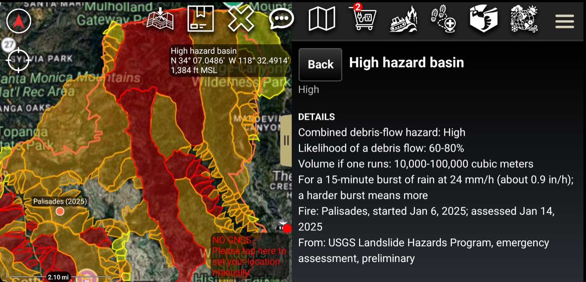

**Earthquakes** draws the USGS feed the way USGS's own map does: a circle sized
by magnitude, colored by age (past hour red, past day orange, past week yellow,
older white), the magnitude in the pill on every one. The first row picks the
past hour, day, week or month (the month feed carries M2.5 and up only); the second
row, **Magnitude**, picks All, M1+, M2.5+ or M4.5+, M2.5+ on a new
install. For up to five of the largest quakes of M4.5 or more, the ShakeMap's
intensity contours are drawn in USGS's intensity colors with their Roman
numeral, VI "Strong" and so on. Tap a quake for the magnitude and its type, the
place, the time and how long ago, the depth, how many people reported feeling
it and how hard, the PAGER impact level, whether USGS flagged a tsunami, whether
a seismologist has reviewed it, and the USGS event page. Worldwide, every five
minutes.

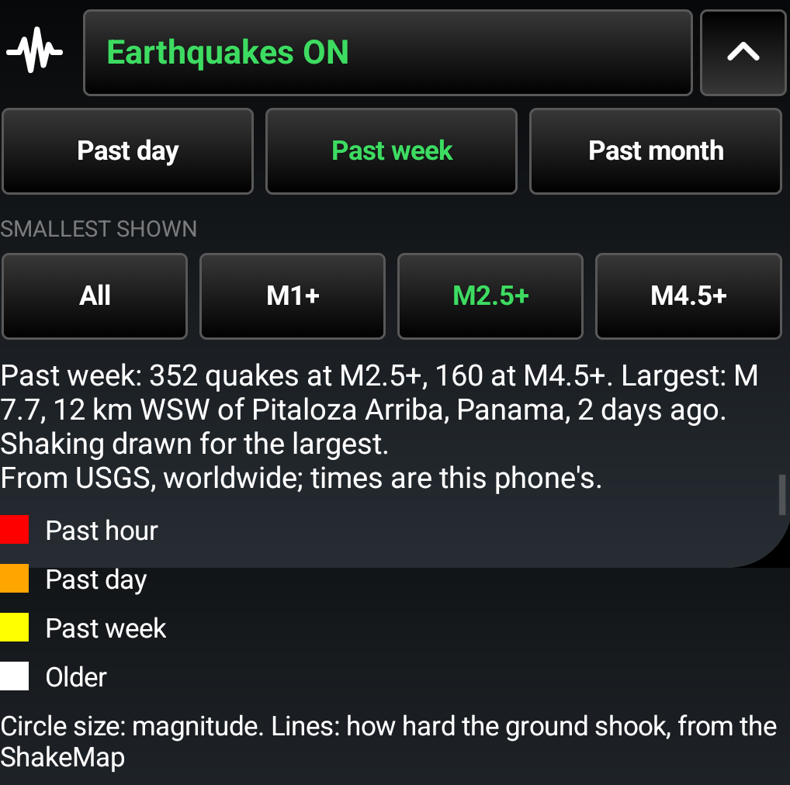 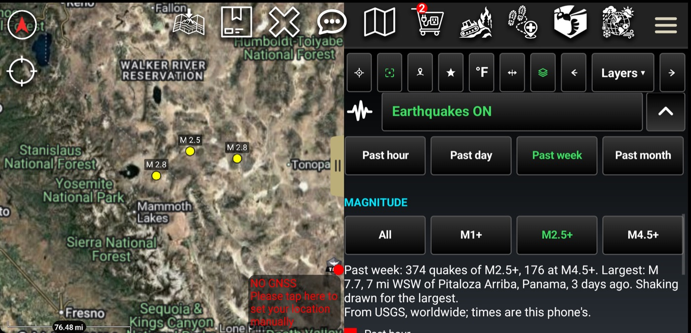

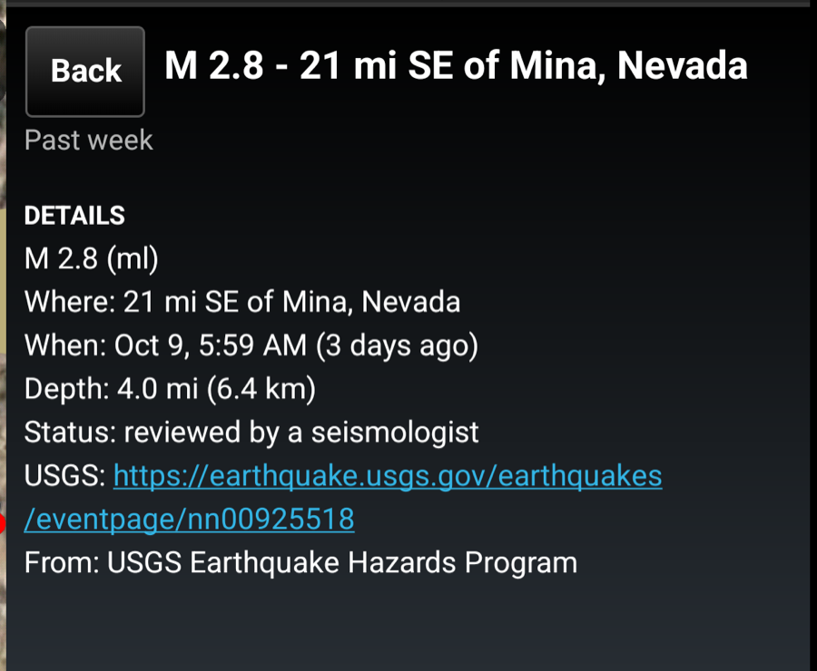

## 10. Rain Totals and Rain Gauges

Both say how much rain fell, for the time you pick with the **Totals:** button
under each switch: the last 24 hours, 3, 7 or 30 days, since October 1 (the
water year), since January 1, one day, or **Before a date and time**, the hours
before a moment you pick, such as when a fire started. Rain Totals also offers
the last hour and 6 hours. While it works, the Rain Gauges page says "Getting
the rain for ..." over a moving bar.

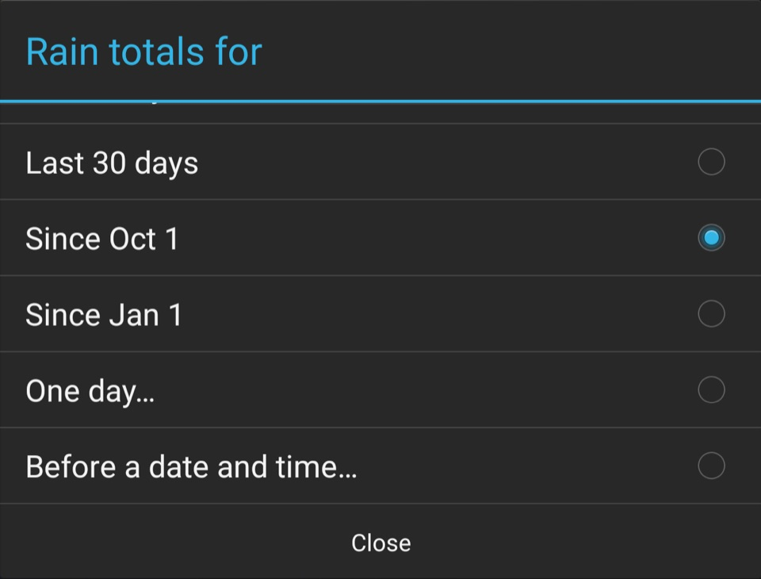 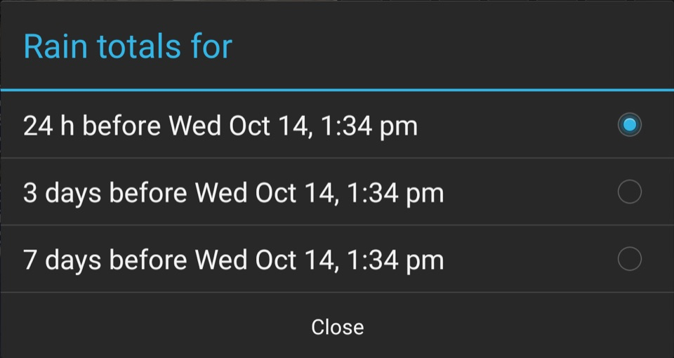

**Rain Totals** draws the rain that fell as a picture over the map, in the
NWS's own colors, with the key under the switch; the key changes with the time
picked. Up to 3 days it is the NWS radar estimate at 1 km, updated every hour,
so a storm that just ended is there at once. For 7 and 30 days and the seasons
it is the River Forecast Centers' analysis of radar corrected by the rain
gauges. Where a center has not produced it yet (all of California on October 15,
2026) its picture is grey; for 7 days the radar estimate for the same 7 days
fills the grey in, and for longer the status line says so. Before a date and time
is the radar estimate as it stood at that hour, kept hour by hour by the Iowa
Environmental Mesonet and, for the last 45 days, on takwerx's server, where
Atmosphere gets it: the picture is of the hour at or before the time you pick,
1, 24, 48 or 72 hours of it, and the calendar starts 45 days back. The radar is good at where it rained and the
shape of the storm, fair on how much: a sprinkle often shows where a gauge
caught nothing, and a 1 km square with no rain is left clear, so light rain
leaves square gaps. Use it for where it rained and a gauge for how much. The
**Transparency** slider lets the map show through. Lower 48 only.

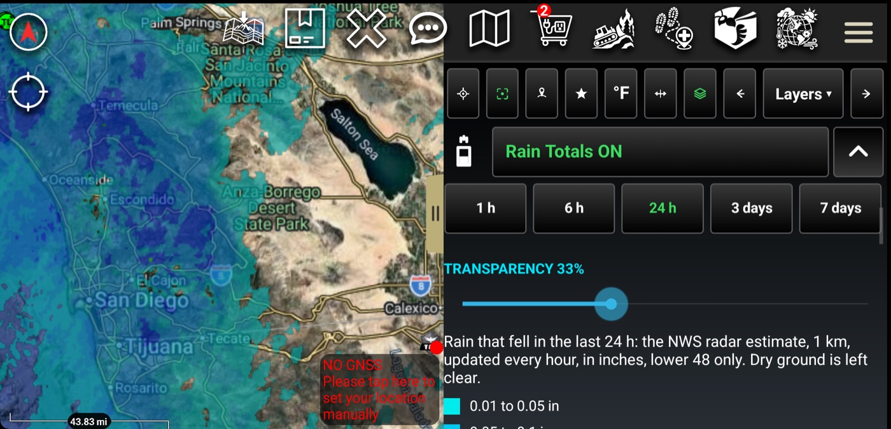

**Rain Gauges** draws each gauge as a dot in the same colors as Rain Totals for
the same time, with its name and its inches in the pill, "Camp 9 0.37 in", so a
dot reads like the shading under it. White-ringed: USGS gauges. Dark-ringed:
airports, NWS weather observers, county flood control, RAWS and other agency
gauges. Only measured gauges, no volunteer gauges. A gauge that missed part of
the time picked is left off, since its total would read as dry ground where it
is a gap, and so is one that disagrees with every gauge around it, the way a
faulty gauge does; the status line says how many were left off. The gauges
come from the USGS, the NOAA Regional Climate Centers (airports and observers,
for runs of days) and the Iowa Environmental Mesonet (the NWS gauge feed the
forecast offices write their rainfall reports from, and the airports' hourly
reports), through takwerx's server, which keeps their hours for 45 days.
Further back, the county and RAWS gauges show whole days, from the day the
time starts to the day you picked, and the airports are left out; the status
line says so. For 3 or 7 days and for the hours before a moment, the USGS, county
and RAWS gauges wait for the map to be zoomed in to about 150 miles across, and
the status line says so; airports and observers show at any zoom. For a month
or more only the USGS gauges that keep daily totals show. The map's area and
the states under it are sent with the dates, not your position.

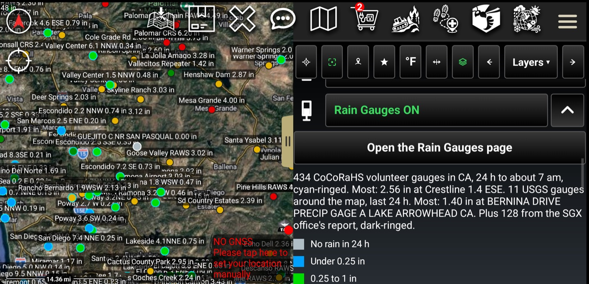

With both layers on the same time, each dot sits on shading of its own color, so
a gauge that caught more or less than the radar shows stands out:

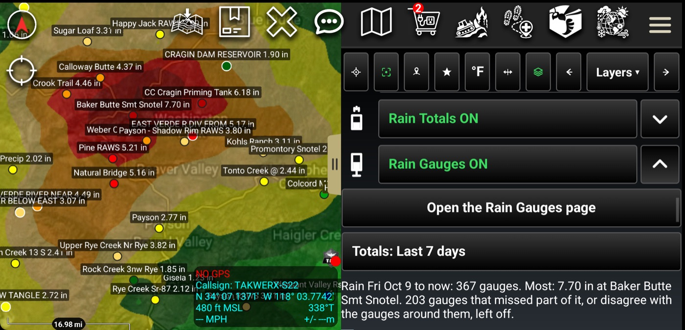

**The Rain Gauges page** has the Totals button at the top, then the gauges in
the map's view, **Most rain first** or **Closest** to your point, with the
miles on each row and a green **Go to** that flies the map in close and opens
the gauge's details: its inches, for a run of days day by day, where it comes
from and its link. At the bottom, **Show the NWS office's rainfall report**
opens the forecast office's own report for the point in the pane's top row, for
the period the forecaster names, as a table in the same colors, Most rain first
or Closest, and the report as the office wrote it one tap further. Thirty-three
offices publish such a report, Los Angeles and San Diego among them; it needs
NWS as the forecast service. Its gauges are among the ones on the map, so the
report is not drawn there.

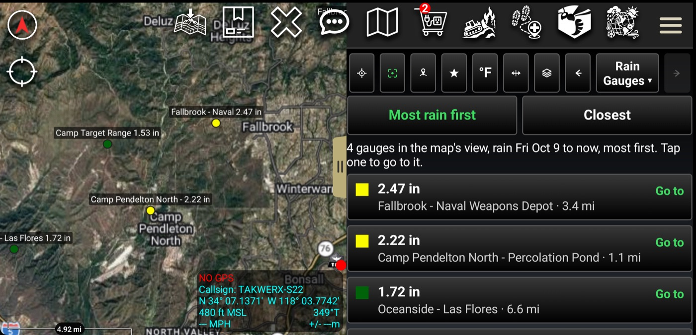 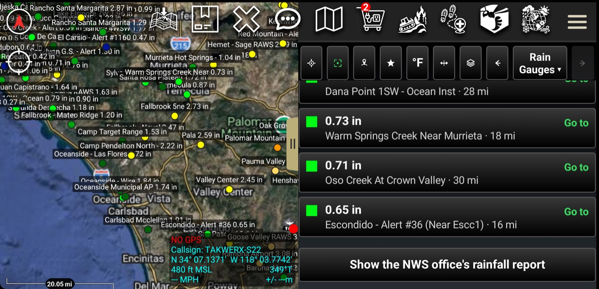

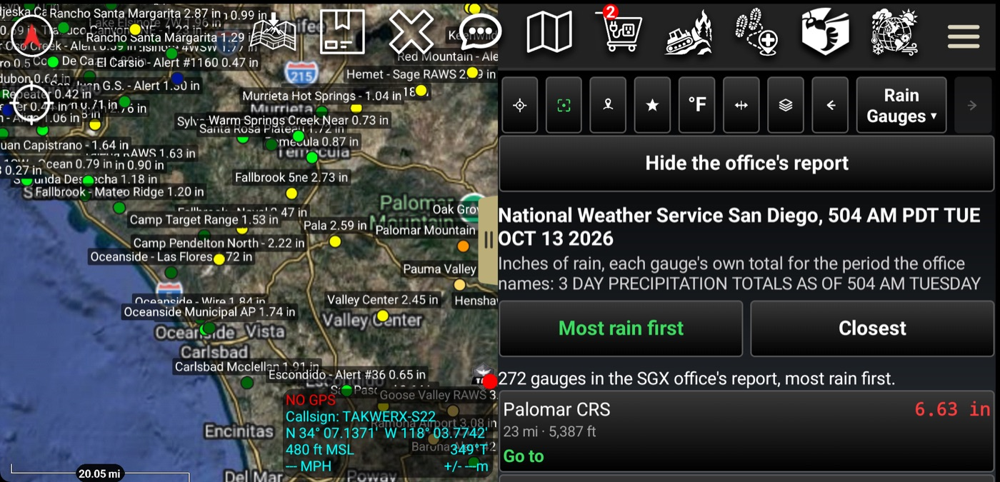

## 11. Spot Weather Forecast

The layer draws every spot forecast request the National Weather Service has
open, with the forecast the office wrote for each. The page lists them under
one row of buttons: the first reads where the list looks and how many it holds,
and opens the choices beneath it (All, Nearby, On map, by State or by Region);
the next flips between **Newest** and **Closest** first; and the magnifier at
the end of the row opens a search box that finds one by incident name, which a
second tap closes and clears. Nearby and Closest measure from the point chosen
in the top row. Tap a request for its forecast.

 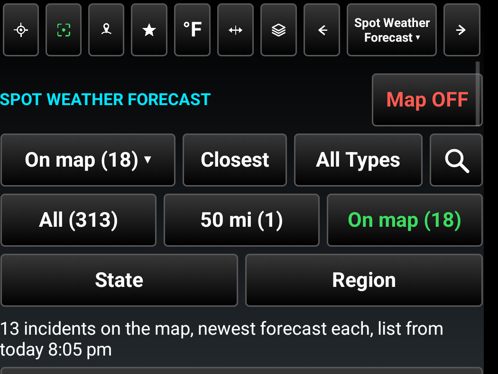

**All Types** picks one kind of request, with how many there are of each; the
kind picked applies to the map as well as the list. Under the layer's arrow the
key shows each kind's icon and what the three colors mean, and **Last 3 days
only** keeps both to requests asked for or answered in the last three days.

 

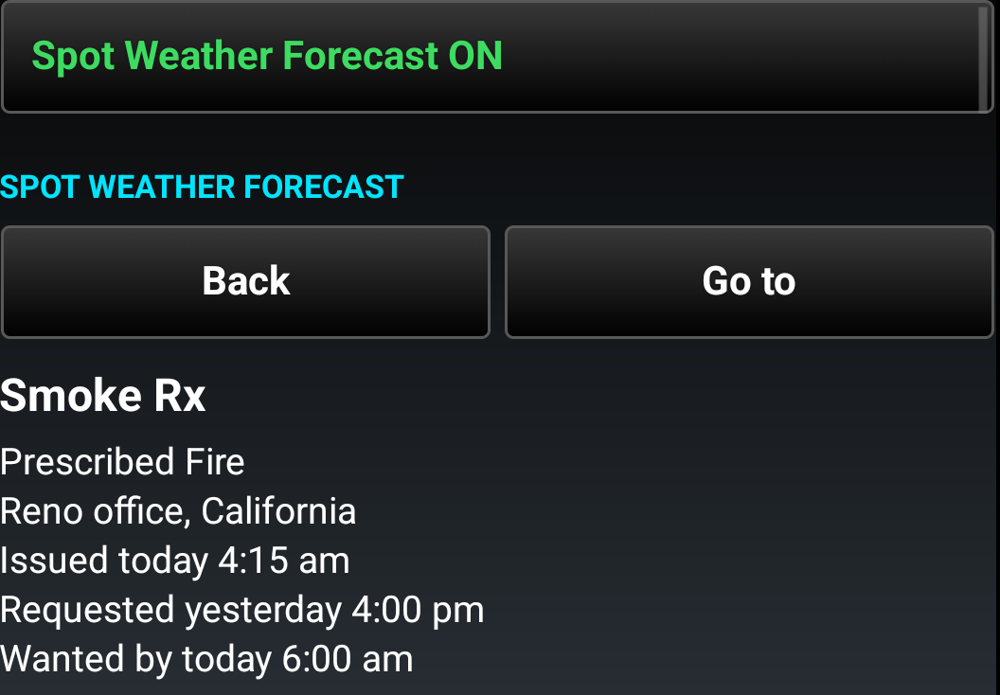

**Request a spot forecast** prepares yours: pick the point — My position, Map
center, Pick on map, a Favorite, or an Address — and the plugin copies it in the
form the Weather Service's web form takes. Open the form, hold its USNG box,
paste, and press Plot USNG. An address is looked up by the US Census Bureau
first; you see what came back before it is used.

 

## 12. The user manual

The manual is inside the plugin. Open ATAK's **Settings**, then **Tool
Preferences**, **Specific Tool Preferences**, **Atmosphere**, and tap
**Atmosphere user manual**.

## 13. What it does not do

- It draws no warnings, watches or advisories, except Red Flag Warnings and
  Fire Weather Watches on its fire weather zones. IPAWS Alerts does the rest.
- Its lightning is a 15-minute density map that arrives 10 to 25 minutes
  late, not single strikes as they happen, and not a lightning safety trigger.
- Its power shutoffs are California's three big utilities only, as Cal OES,
  SCE and SDG&E publish them; anywhere else, ask the utility.
- Its storm reports are preliminary, as the offices received them, and its
  tornado paths are each office's survey until it finalizes it; its debris-flow
  hazard is the USGS's for one design storm, not a forecast of rain; its
  earthquakes are USGS's feed, not an early warning. None of these is an alert.
- It publishes nothing: no path puts anything on another phone or a server.
- It records nothing about you: no callsign, device identifier or TAK server
  detail is ever sent. Your position leaves the device only for the forecast
  when it is set to My position, rounded to about 100 m, and for the station,
  gauge and buoy lists, which are measured from the same point, rounded the
  same way. The Fire Weather Zones
  page finds your zone by sending the half-degree square the point is in, about
  30 miles across, never the point. Debris Flow, Rain Totals and Rain Gauges
  send the area the map shows, padded. Fuel Moisture sends the two-letter code
  of the state under the map center, and Rain Gauges the codes of the states
  under the map with the dates, found on this device. The office's rainfall report and the
  synopsis find the office by the same half-degree square, and only while NWS
  is the forecast service.
