# Fire Cast for ATAK — User Guide

**Version 0.2 · takwerx**

**Download Fire Cast 0.2** (pick the one matching your ATAK-CIV version, sideload, then load it in ATAK's Plugins manager):

- **ATAK-CIV 5.6:** https://github.com/takwerx/fire-cast/releases/download/v0.2/ATAK-Plugin-FireCast-0.2--5.6.0-civ-release.apk
- **ATAK-CIV 5.7:** https://github.com/takwerx/fire-cast/releases/download/v0.2/ATAK-Plugin-FireCast-0.2--5.7.0-civ-release.apk
- **ATAK-CIV 5.8:** https://github.com/takwerx/fire-cast/releases/download/v0.2/ATAK-Plugin-FireCast-0.2--5.8.0-civ-release.apk

All releases: https://github.com/takwerx/fire-cast/releases

**Before you start:** the builds listed above are the ATAK-CIV versions with a published Fire Cast build. Install the one that matches the ATAK on your device.

Fire Cast puts satellite heat detections on the ATAK map and lets you run a fire spread model on the device, from a point you tap or a perimeter you draw. It also shows other agencies' published fire forecasts beside your own runs.

---

## 1. The pane

Tap the Fire Cast icon in the toolbar. The pane opens on the right.

From the top:

- **Detections in view**, and how long ago they were fetched.
- **Where is it burning?** A short summary of the fire activity in the area on screen.
- **Fire model** opens the model page (section 3).
- **FIRIS Model Runs** and **PyreCast Forecasts**: other people's spread runs, one switch each (section 4).
- **Feeds**, the heat detection feeds, each with its own switch.

A switch reads `<Name> ON` in green or `<Name> OFF` in red.

## 2. Heat detections

The feeds:

- **VIIRS** — three satellites, a few passes a day. Each detection is drawn as the square the sensor actually saw, about 375 m across.
- **MODIS** — Terra and Aqua. A MODIS pixel is 1 km at the center of the swath and grows past 4 km at the edge, so the drawn box grows with it.
- **GOES** — a scan every few minutes. These have no footprint of their own, so it is worked out from the satellite's viewing angle.
- **RADR** — burned areas mapped from satellite passes over the last fourteen days. These are real outlines of where fire has been, not where it is.

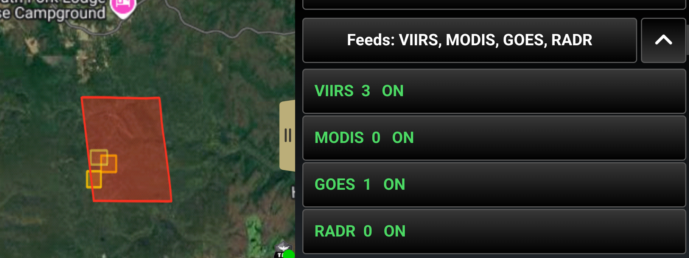

Above, three VIIRS detections (the small squares, each the 375 m the sensor saw) inside one GOES detection (the large box, worked out from the satellite's viewing angle) on the same fire. The feeds list beside them gives each feed's count in view.

Detections are colored by age, red within the hour, through amber, to gray after a day, and fade with it. **Filters** sets the time window (three hours to three days), the confidence, and whether to hide known industrial heat sources such as flares and solar farms. **Map key** explains the colors.

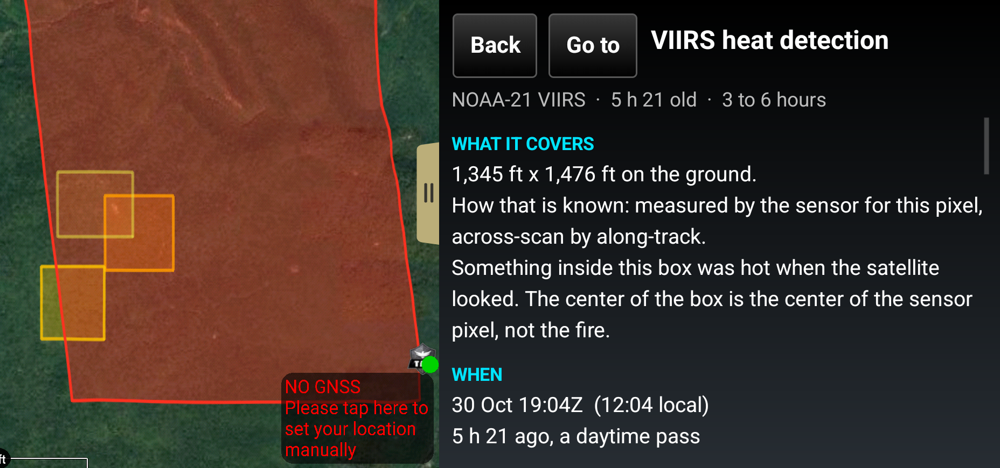

Tap a detection on the map or in the list for its detail panel: how big the footprint is and how that was worked out, when the satellite saw it, the radiative power, and a section called **What this does not mean**. A heat detection is a hot pixel. It does not say the fire is at the center of the box, that an empty map is empty ground, or that a hot pixel is a wildfire rather than a flare.

### Where is it burning?

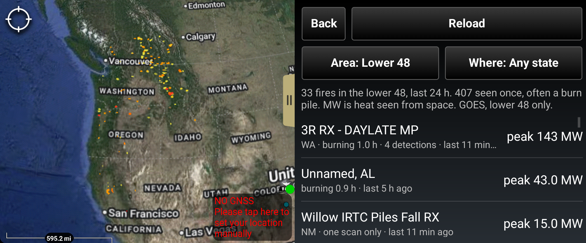

**Where is it burning?** groups the detections into fires and lists them, biggest heat first: the state, how long it has been burning, how many detections and when the last one was. **Area** and **Where** narrow the list. A fire seen in only one scan says so; that is often a burn pile.

## 3. The fire model

Tap **Fire model**.

### Start a run

1. Tap **Place start**, then tap the map where the fire starts. A marker labeled *Fire start* is placed. Drag it, or use Fine Adjust on its menu, to make it exact.
2. Set what you know:
   - **Conditions:** *As observed* at the weather station, *As observed but at the gust*, *Dry day*, or *Dry and 20 mph wind*. The last two are for planning what a bad day would do.
   - **Station:** *automatic* picks a nearby weather station by distance and height, so a station on a ridge does not stand in for a valley. Tap it to pick one by name.
   - **Draw perimeter:** trace the fire's current edge on the map. The run then starts from that edge, with everything inside already burning.
   - **Started:** how long ago the fire started, from not known to three hours. With a drawn perimeter this calibrates the model's speed.
   - **Horizon:** one hour or three hours ahead.
3. Tap **Run model**. It takes a few seconds.

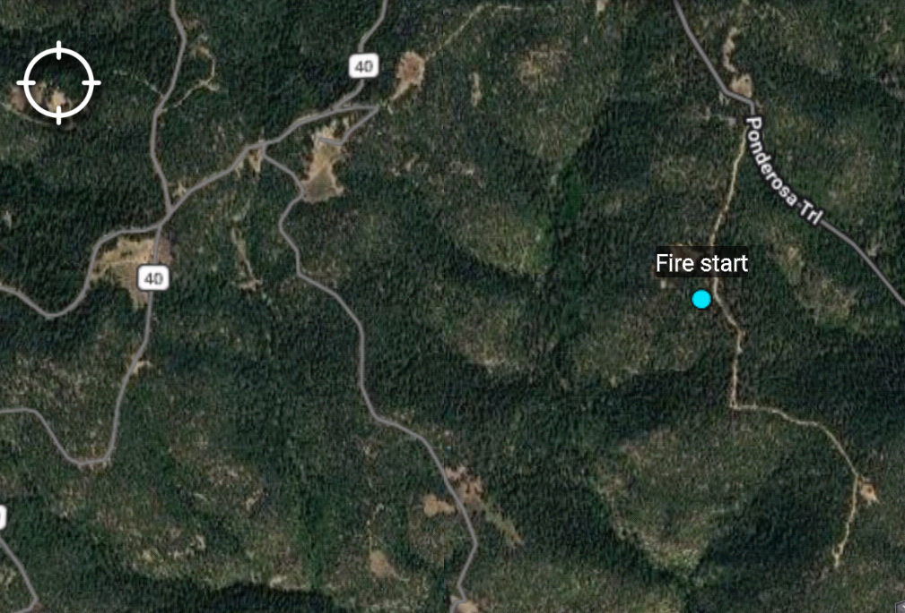

### What goes into the model

Everything below is fetched for the run and runs on the device. No run is sent anywhere.

**The ground.** From LANDFIRE (USGS and the Forest Service), in 30 m cells, for a square 4 km each way around the start (10 km for a three-hour run):

- the fuel model, one of the 40 Scott and Burgan fuel models (grass, grass-shrub, shrub, timber understory, timber litter, slash);
- the slope and which way the slope faces;
- the canopy: tree cover, tree height, the height of the lowest branches, and how dense the crowns are;
- the vegetation type, which is how the model tells houses, roads and parks apart inside LANDFIRE's single urban class.

The fire moves over this in 15 m steps (30 m for three hours).

**The wind.** Three sources, the best one there is:

- a weather station near the fire, a RAWS fire weather station or a National Weather Service station, picked by distance *and* height, so a station on a ridge does not stand in for a valley. **Station** on the model page picks one by name;
- for the hours ahead, the National Weather Service hourly forecast at the start;
- where it is available, the HRRR 3 km wind forecast from NOAA, which varies across the ground and hour by hour.

**How dry the fuel is.**

- Dead fuel (the 1 h, 10 h and 100 h sizes, twigs to logs): the Forest Service's fire danger figures for the nearest station, with the 1 h worked out from that station's humidity and temperature. With no station, the WFAS national grid.
- Live fuel (brush, grass, conifer needles): the nearest field sample in the National Fuel Moisture Database from the last 45 days, or the seasonal figure when nobody has sampled nearby.

**How it burns.** The Forest Service Fire Lab's Behave library, the same engine as BehavePlus, compiled into the plugin: Rothermel's surface fire spread, Scott and Reinhardt's crown fire (whether the fire stays on the ground, torches single trees or runs through the crowns), and Albini's ember distances.

**How it spreads.** Cell by cell over the real ground, each cell at its own fuel, slope, canopy and wind. Embers carry it across a road or a block narrower than they fly. Roads slow it; commercial blocks, water, bare ground and farmed ground stop it. Houses burn house to house at the rate measured in nine North American conflagrations (Moran, Seielstad and Pietruszka, 2025).

**What it reaches.** Buildings and the people in them from FEMA's national building inventory (USA Structures). A building counts when the fire reaches the ground beside it.

**From a drawn perimeter.** With a perimeter and a start time, the model first runs from the middle of the perimeter for the time the fire has burned and compares that with what it actually covered. It then scales its rates to match, at most three times faster or slower, and says so on the page.

**Predicted Fire Size.** The run is repeated 30 times with the wind speed, wind direction and fuel moisture nudged the way forecasts miss, and ranked by how much burned (below).

**What is not in it.** Firefighting. Wind the fire makes itself. Wind bent by a canyon finer than the forecast grid. A fuel break narrower than 15 m. How the fuel looks today if it has changed since LANDFIRE mapped it.

### Reading a result

- The line at the top says where the fire is by a time, with its area, how far it has gone and how many buildings.
- The **time slider** moves the rings on the map between the start and the end of the run. The edge at the slider's time is drawn in cyan.
- The **table** lists each time step with the area in acres, buildings and people reached.

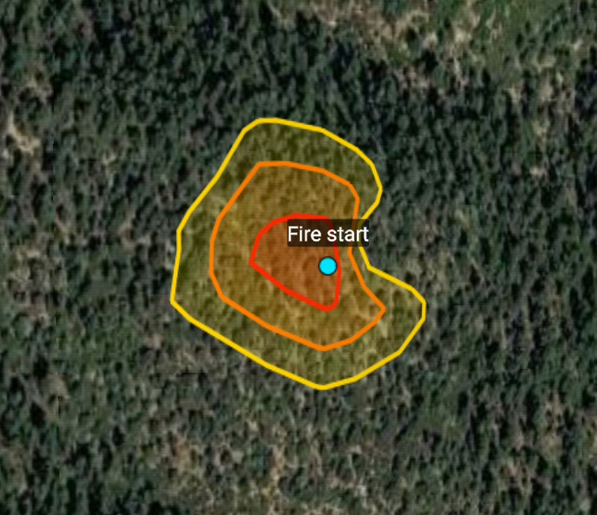

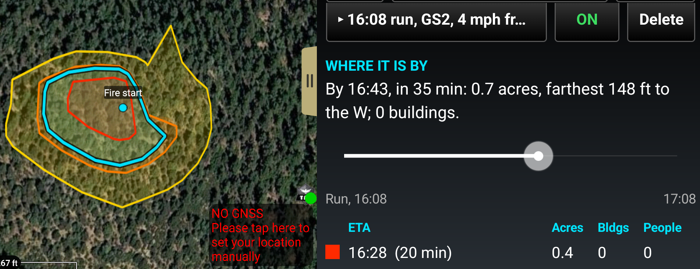

Drag the slider and the cyan edge moves to that time, with the line above it saying where the fire is by then.

On the map each time step is a ring, red for the first, then orange, then yellow, with the burned ground filled in.

A run can be small. A litter fire under trees in a light wind may cover a fraction of an acre in an hour, and the page says so: *A slow fire: the fuel here carries fire at ...*. Set **Conditions** to *Dry and 20 mph wind* to see what a bad day would do from the same start.

### Predicted Fire Size

A fire does not spread exactly as forecast. The wind misses, the fuel is drier or wetter than measured. Fire Cast repeats each run 30 times with the wind speed, wind direction and fuel moisture nudged the way a forecast misses, ranks the 30 by how much burned, and offers five of them.

Tap **Predicted Fire Size** to pick **Smallest**, **Smaller**, **Median**, **Larger** or **Largest**. It starts on Median. Everything on the page and the map becomes that one run: the rings, the slider, the acres and the buildings. The five names and the percentile wording match PyreCast's.

| Smallest | Largest |
|---|---|
| 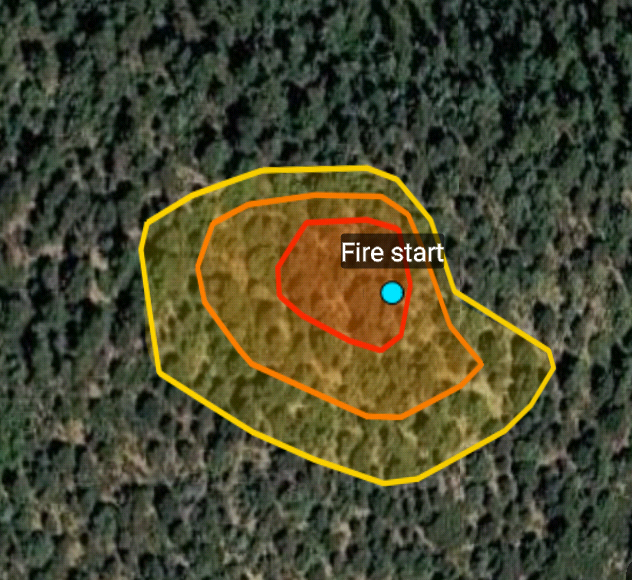 | 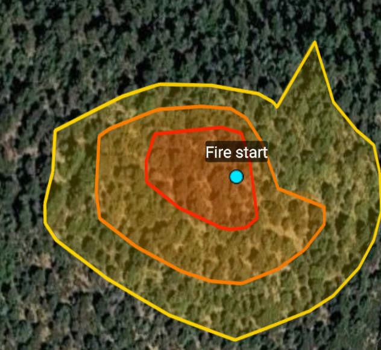 |

The same start, the same map: the smallest of the 30 runs and the largest. In a light wind they are close; the stronger the wind, the further apart they come.

### The detail pills

Under the results, the rest is folded away so the page does not become one long scroll. A closed pill shows its first line. Tap a pill to open it, tap again to close it.

- **Where it goes:** each time step in words, with embers, crown fire and the buildings reached.
- **About Predicted Fire Size:** what the picker is.
- **Burn behavior:** flame length and fireline intensity, with what a hand crew can hold, and what the run does not mean.

- **What went in:** the fuel, slope and canopy, the wind and where it came from, and the moisture. Check this first when a run looks wrong: a station far from the fire is the usual reason.

At the bottom, **Rerun from this start** runs it again with fresh weather, and **Send this run** shares the run as one file through ATAK's Send dialog.

### Runs on the map

Each run is listed with its time, fuel, wind and area. **ON** and **OFF** show or hide it on the map. **Delete** removes it. Runs are kept on the device.

## 4. Other forecasts

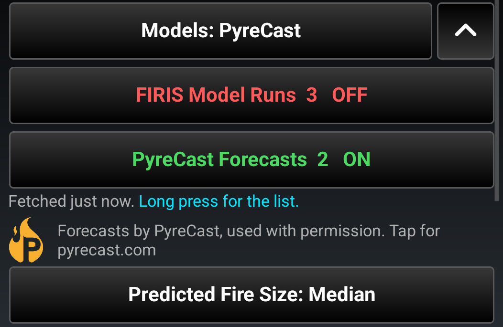

**FIRIS Model Runs** shows the spread runs that California's fire analysts publish for ATAK. **PyreCast Forecasts** shows the ELMFIRE forecasts PyreCast (CloudFire, Inc.) publishes for large fires across the country, shown with their permission, with their logo and a link to pyrecast.com. Each is a switch in the pane. Long press a layer's switch for its list, and pick a fire to put its time slider on it.

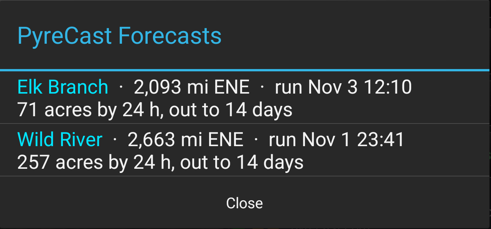

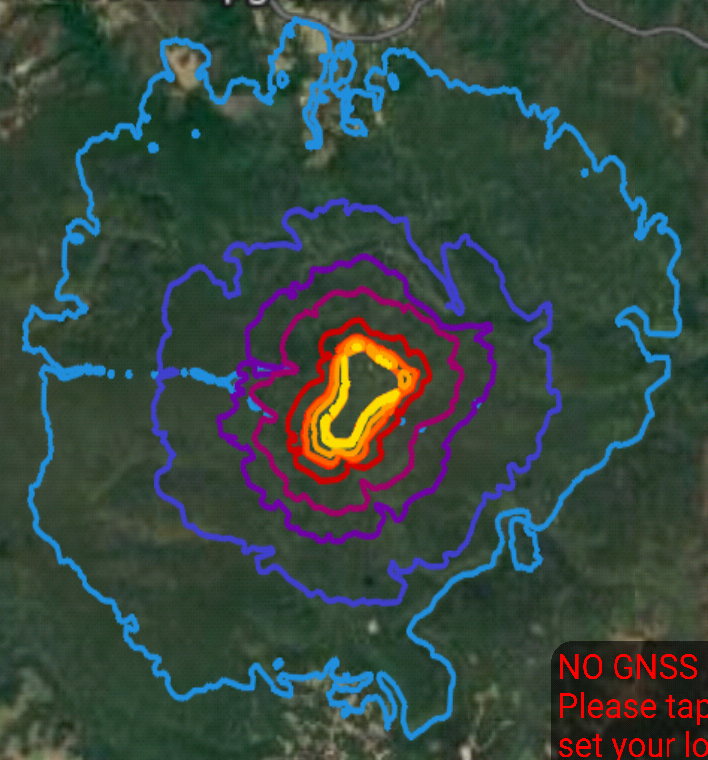

Each forecast runs out to about two weeks, drawn from yellow for the first hours to blue for the last.

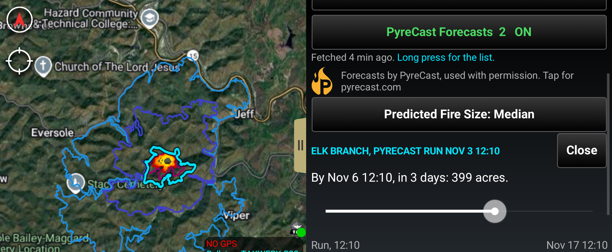

Drag the slider to any time in the forecast. The edge at that time is drawn in cyan, and the pane says where the fire is by then: *By Nov 2 11:04, in 3 days: 1,236 acres.*

PyreCast ranks its own runs by how much burned at the end of the forecast. Fire Cast shows the middle run unless you pick the smaller or larger end, and shows one run at a time.

## 5. Offline

Everything Fire Cast has fetched or run stays on the device. After a restart of ATAK, or with no signal, your runs, the last detections and the PyreCast forecasts come back, with their age on the pane. Switching a layer off only hides it. A failed fetch never empties what you already have, and a new run with no signal says what it could not reach, for example "Could not read the fuel and slope here", and leaves your other runs alone.

## 6. What to keep in mind

A spread model gives a direction and an order of magnitude. It is not a plan to base a perimeter on. Fuel and slope are the real ground, but the wind is one reading or a coarse forecast and cannot know a canyon, there is no suppression in it, and house-to-house spread is an average over past fires, not this street. Run it again as the wind changes.

## Questions and bugs

Open an issue at https://github.com/takwerx/fire-cast/issues.
