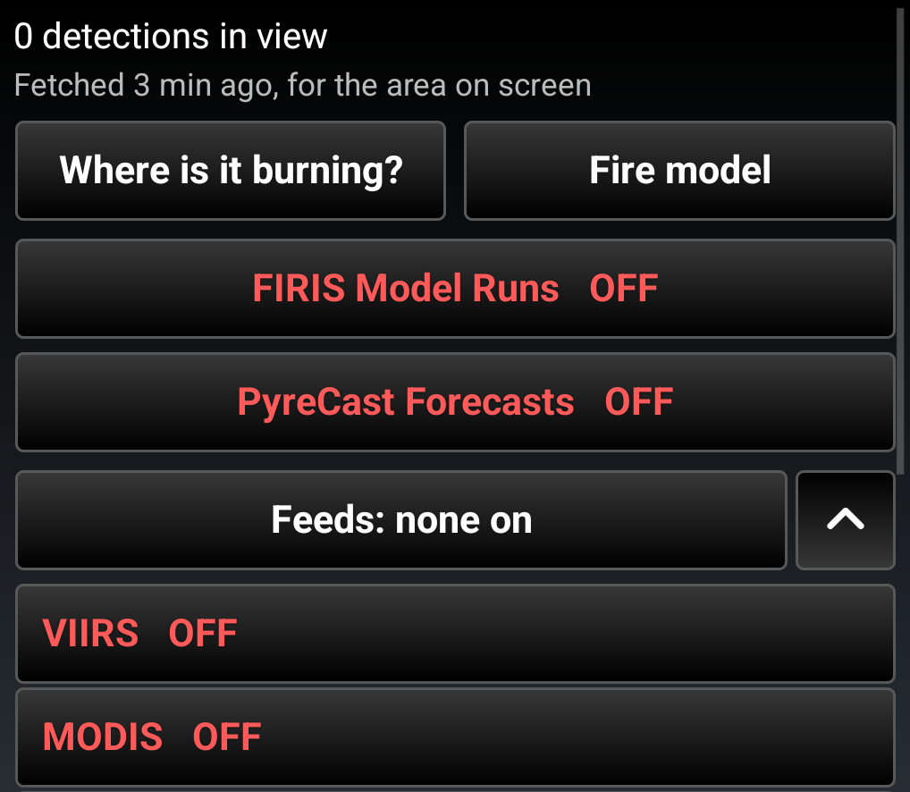
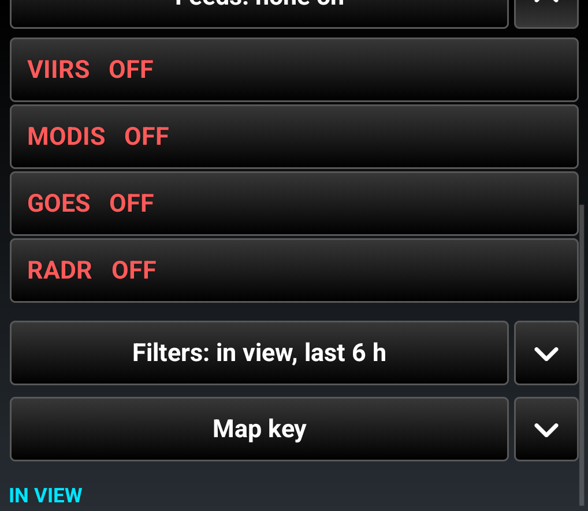
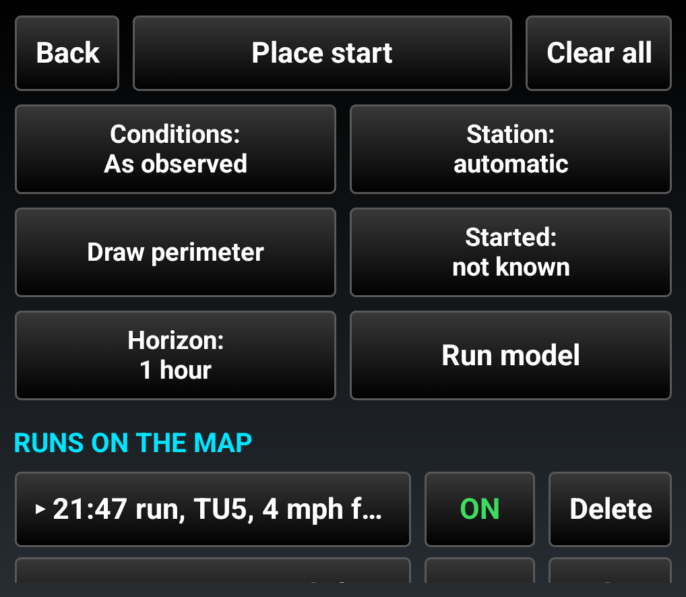
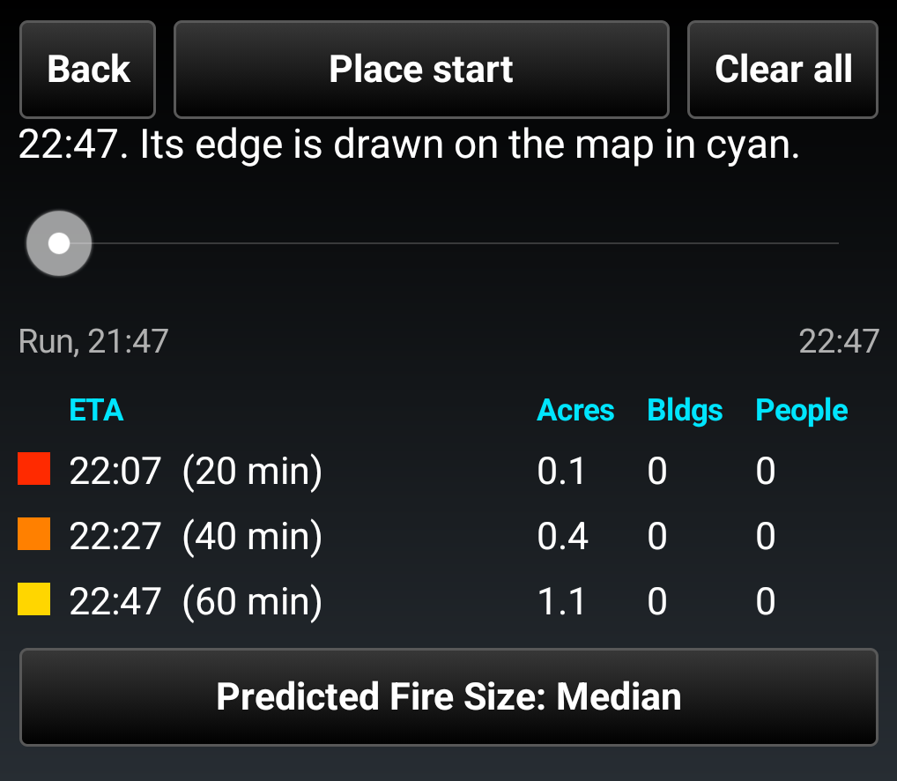
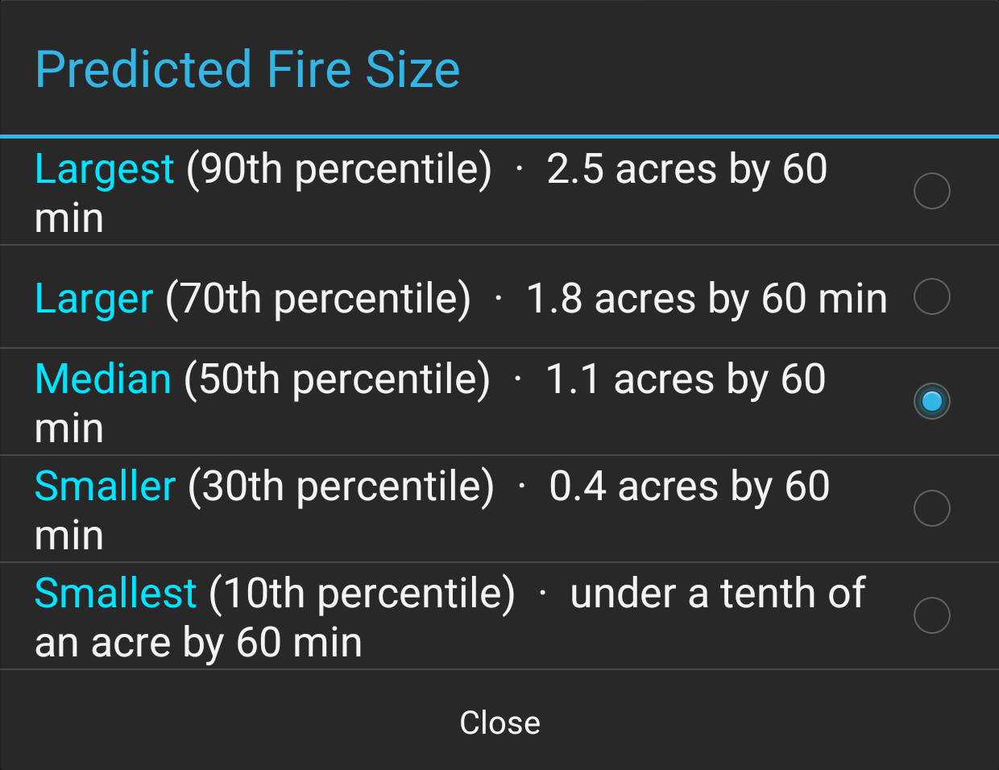
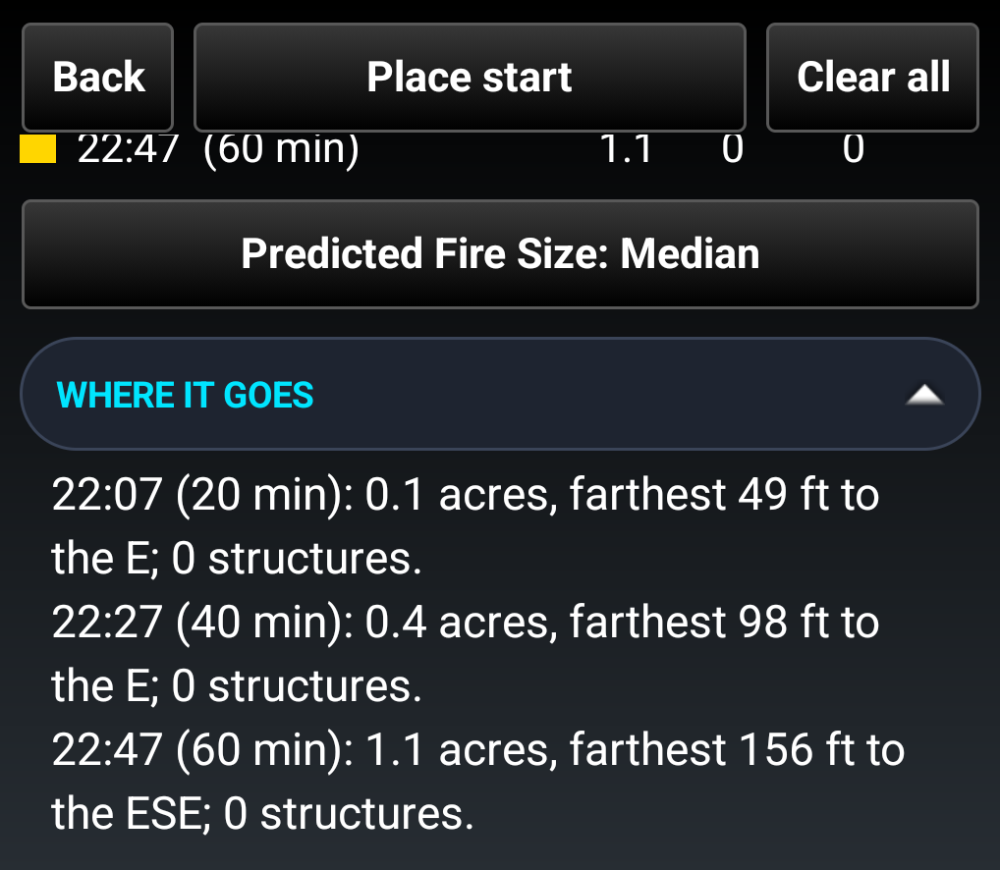
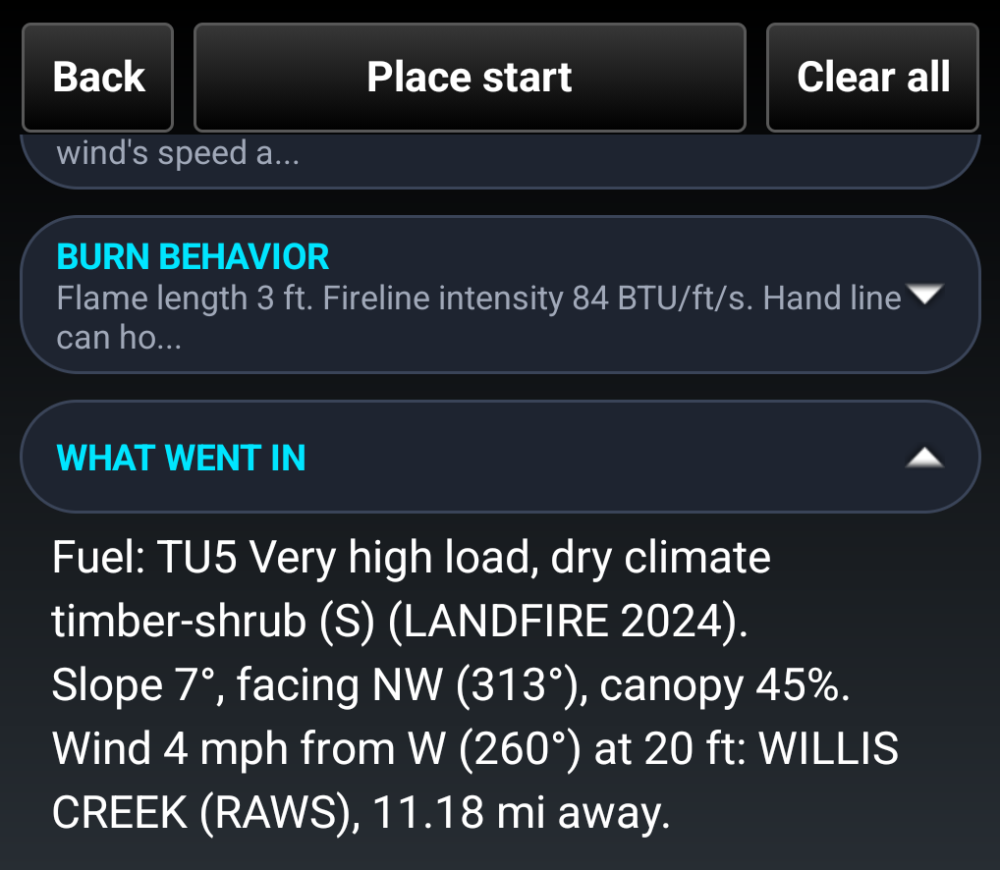

# Fire Cast for ATAK — User Guide

**Version 0.1 · takwerx**

**Download Fire Cast 0.1** (pick the one matching your ATAK-CIV version, sideload, then load it in ATAK's Plugins manager):

- **ATAK-CIV 5.6:** https://github.com/takwerx/fire-cast/releases/download/v0.1/ATAK-Plugin-FireCast-0.1--5.6.0-civ-release.apk
- **ATAK-CIV 5.7:** https://github.com/takwerx/fire-cast/releases/download/v0.1/ATAK-Plugin-FireCast-0.1--5.7.0-civ-release.apk
- **ATAK-CIV 5.8:** https://github.com/takwerx/fire-cast/releases/download/v0.1/ATAK-Plugin-FireCast-0.1--5.8.0-civ-release.apk

All releases: https://github.com/takwerx/fire-cast/releases

**Before you start:** the builds listed above are the ATAK-CIV versions with a published Fire Cast build. Install the one that matches the ATAK on your device.

Fire Cast puts satellite heat detections on the ATAK map and lets you run a fire spread model on the device, from a point you tap or a perimeter you draw. It also shows other agencies' published fire forecasts beside your own runs.

---

## 1. The pane

Tap the Fire Cast icon in the toolbar. The pane opens on the right.

From the top:

- **Detections in view**, and how long ago they were fetched.
- **Where is it burning?** A short summary of the fire activity in the area on screen.
- **Fire model** opens the model page (section 3).
- **FIRIS Model Runs** and **PyreCast Forecasts**: other people's spread runs, one switch each (section 4).
- **Feeds**, the heat detection feeds, each with its own switch.

A switch reads `<Name> ON` in green or `<Name> OFF` in red.

## 2. Heat detections

The feeds:

- **VIIRS** — three satellites, a few passes a day. Each detection is drawn as the square the sensor actually saw, about 375 m across.
- **MODIS** — Terra and Aqua. A MODIS pixel is 1 km at the center of the swath and grows past 4 km at the edge, so the drawn box grows with it.
- **GOES** — a scan every few minutes. These have no footprint of their own, so it is worked out from the satellite's viewing angle.
- **RADR** — burned areas mapped from satellite passes over the last fourteen days. These are real outlines of where fire has been, not where it is.

Detections are colored by age, red within the hour, through amber, to gray after a day, and fade with it. **Filters** sets the time window (three hours to three days), the confidence, and whether to hide known industrial heat sources such as flares and solar farms. **Map key** explains the colors.

Tap a detection on the map or in the list for its detail panel: how big the footprint is and how that was worked out, when the satellite saw it, the radiative power, and a section called **What this does not mean**. A heat detection is a hot pixel. It does not say the fire is at the center of the box, that an empty map is empty ground, or that a hot pixel is a wildfire rather than a flare.

## 3. The fire model

Tap **Fire model**.

### Start a run

1. Tap **Place start**, then tap the map where the fire starts. A marker labeled *Fire start* is placed. Drag it, or use Fine Adjust on its menu, to make it exact.
2. Set what you know:
   - **Conditions:** *As observed* at the weather station, *As observed but at the gust*, *Dry day*, or *Dry and 20 mph wind*. The last two are for planning what a bad day would do.
   - **Station:** *automatic* picks a nearby weather station by distance and height, so a station on a ridge does not stand in for a valley. Tap it to pick one by name.
   - **Draw perimeter:** trace the fire's current edge on the map. The run then starts from that edge, with everything inside already burning.
   - **Started:** how long ago the fire started, from not known to three hours. With a drawn perimeter this calibrates the model's speed.
   - **Horizon:** one hour or three hours ahead.
3. Tap **Run model**. It takes a few seconds.

The model reads the real fuel, slope and canopy from LANDFIRE, wind from the nearest weather station (and the National Weather Service forecast for hours ahead), and how dry the fuels are from the national fuel moisture data. It spreads the fire cell by cell over the real ground, carries embers, lets roads slow it, and counts the buildings and people it reaches from FEMA's building inventory.

### Reading a result

- The line at the top says where the fire is by a time, with its area, how far it has gone and how many buildings.
- The **time slider** moves the rings on the map between the start and the end of the run. The edge at the slider's time is drawn in cyan.
- The **table** lists each time step with the area in acres, buildings and people reached.

### Predicted Fire Size

A fire does not spread exactly as forecast. The wind misses, the fuel is drier or wetter than measured. Fire Cast repeats each run 30 times with the wind speed, wind direction and fuel moisture nudged the way a forecast misses, ranks the 30 by how much burned, and offers five of them.

Tap **Predicted Fire Size** to pick **Smallest**, **Smaller**, **Median**, **Larger** or **Largest**. It starts on Median. Everything on the page and the map becomes that one run: the rings, the slider, the acres and the buildings. The five names and the percentile wording match PyreCast's.

### The detail pills

Under the results, the rest is folded away so the page does not become one long scroll. A closed pill shows its first line. Tap a pill to open it, tap again to close it.

- **Where it goes:** each time step in words, with embers, crown fire and the buildings reached.
- **About Predicted Fire Size:** what the picker is.
- **Burn behavior:** flame length and fireline intensity, with what a hand crew can hold, and what the run does not mean.

- **What went in:** the fuel, slope and canopy, the wind and where it came from, and the moisture. Check this first when a run looks wrong: a station far from the fire is the usual reason.

At the bottom, **Rerun from this start** runs it again with fresh weather, and **Send this run** shares the run as one file through ATAK's Send dialog.

### Runs on the map

Each run is listed with its time, fuel, wind and area. **ON** and **OFF** show or hide it on the map. **Delete** removes it. Runs are kept on the device.

## 4. Other forecasts

**FIRIS Model Runs** shows the spread runs that California's fire analysts publish for ATAK. **PyreCast Forecasts** shows the ELMFIRE forecasts PyreCast (CloudFire, Inc.) publishes for large fires across the country, shown with their permission, with their logo and a link to pyrecast.com. Each is a switch in the pane. Long press a layer's switch for its list, and pick a fire to put its time slider on it.

PyreCast ranks its own runs by how much burned at the end of the forecast. Fire Cast shows the middle run unless you pick the smaller or larger end, and shows one run at a time.

## 5. Offline

Everything Fire Cast has fetched or run stays on the device. After a restart of ATAK, or with no signal, your runs, the last detections and the PyreCast forecasts come back, with their age on the pane. Switching a layer off only hides it. A failed fetch never empties what you already have, and a new run with no signal says what it could not reach, for example "Could not read the fuel and slope here", and leaves your other runs alone.

## 6. What to keep in mind

A spread model gives a direction and an order of magnitude. It is not a plan to base a perimeter on. Fuel and slope are the real ground, but the wind is one reading or a coarse forecast and cannot know a canyon, there is no suppression in it, and house-to-house spread is an average over past fires, not this street. Run it again as the wind changes.

## Questions and bugs

Open an issue at https://github.com/takwerx/fire-cast/issues.
