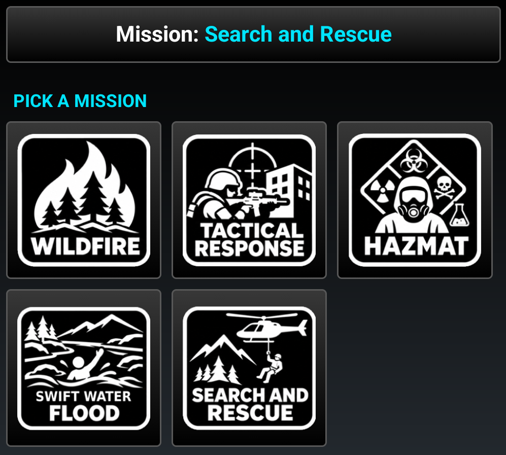
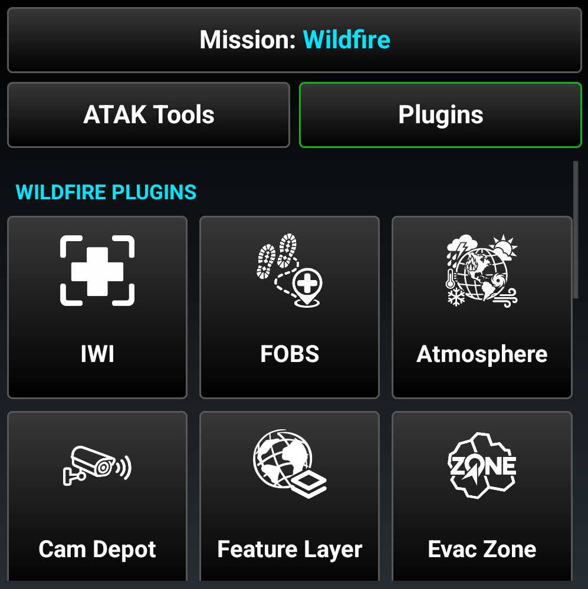
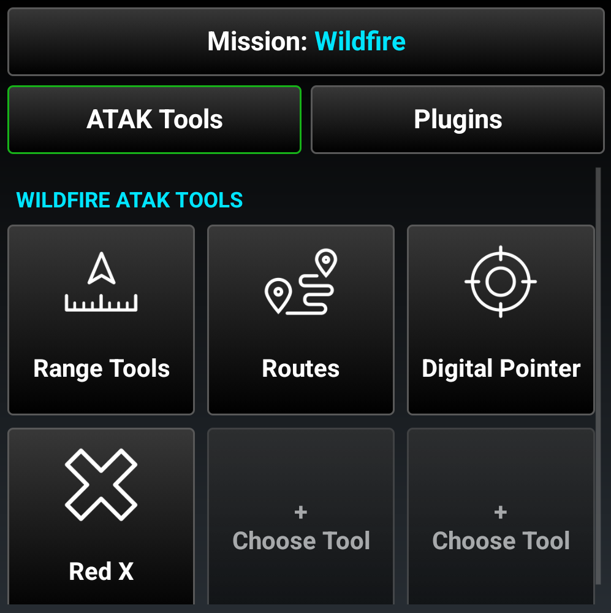
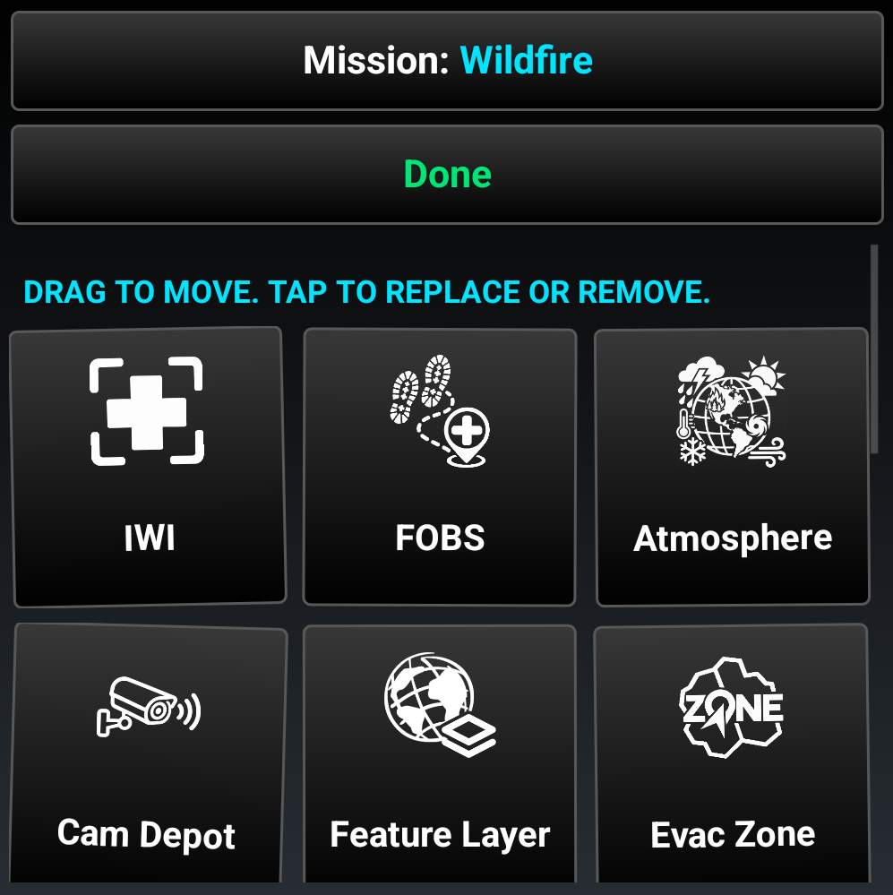
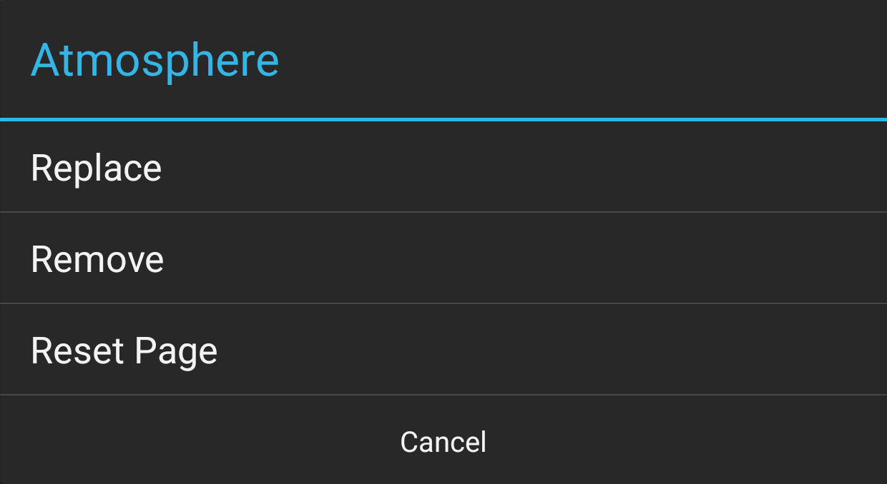
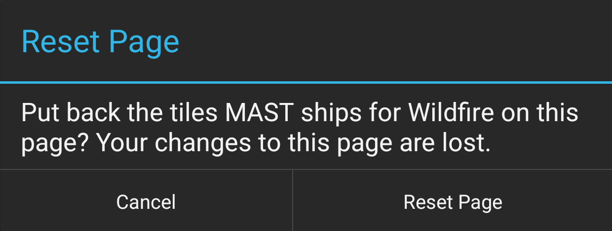
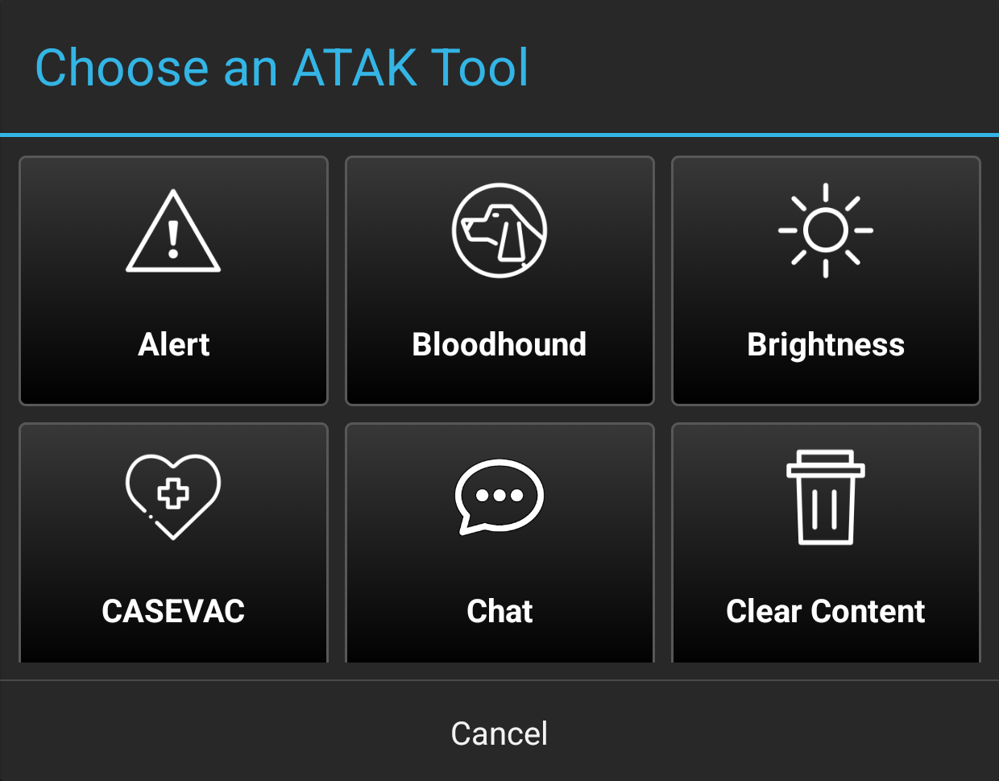
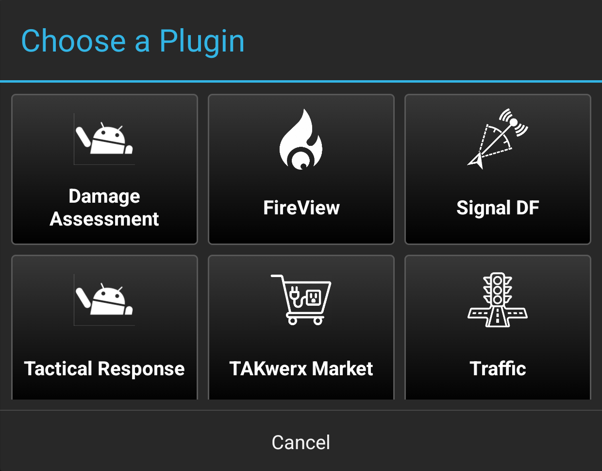
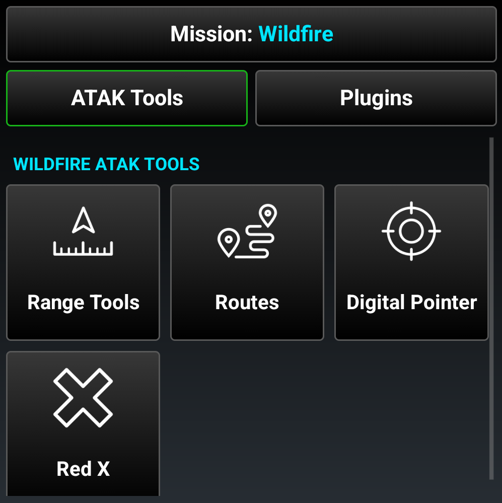
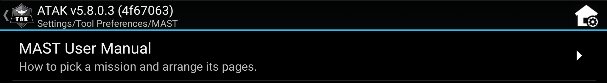

# MAST for ATAK — User Guide

**Version 0.1 · takwerx**

**Download MAST 0.1** (pick the one matching your ATAK-CIV version, sideload, then load it in ATAK's Plugins manager):

- **ATAK-CIV 5.6:** https://github.com/takwerx/mast/releases/download/v0.1/ATAK-Plugin-MAST-0.1--5.6.0-civ-release.apk
- **ATAK-CIV 5.7:** https://github.com/takwerx/mast/releases/download/v0.1/ATAK-Plugin-MAST-0.1--5.7.0-civ-release.apk
- **ATAK-CIV 5.8:** https://github.com/takwerx/mast/releases/download/v0.1/ATAK-Plugin-MAST-0.1--5.8.0-civ-release.apk

All releases: https://github.com/takwerx/mast/releases

MAST, **Mission Adaptable Support Tools**, is the front door to the tools a
mission needs. Pick the mission and MAST shows two pages for it: the ATAK tools
that job uses, and the plugins that job uses. One tap opens any of them.

> **Before you start:** MAST 0.1 has builds for ATAK-CIV 5.6, 5.7 and 5.8. The
> plugins a mission lists are installed separately, for example from the
> TAKwerx Market.

---

## 1. Pick a mission

The first time, MAST opens on the mission list. Tap a mission to open its
pages. To change mission later, tap the **Mission** button at the top of the
pane; the mission in use shows in cyan on it.

MAST remembers the last mission. Tap MAST on the toolbar from inside any plugin
and it opens on that mission's page again.

## 2. The two pages

| Plugins | ATAK Tools |
|---|---|
|  |  |

- **Plugins** shows the mission's plugins. A tile opens that plugin, the same
  as its own toolbar button. A plugin that is not on the device shows as a
  faded **Not installed** tile; tap it and MAST offers to open the TAKwerx
  Market.
- **ATAK Tools** shows ATAK's own tools for the mission. A tile does what the
  same item in ATAK's tool menu does, and MAST closes so the map is yours.
  Maps, Drawing and Overlay Manager are left off on purpose: most people keep
  those on the toolbar already.

The two buttons under **Mission** switch between the pages.

## 3. Arrange a page

Press and hold a tile. The page goes into edit mode: the tiles move a little
and a green **Done** button appears.

- **Drag** a tile onto another tile and the two change places. Nothing else
  moves. Drop it on an empty place and it goes to the end.
- **Tap** a tile for its menu:

- **Replace** puts a different tool or plugin in that place.
- **Remove** takes the tile off the page.
- **Reset Page** puts back the tiles MAST ships for this mission. It asks
  first, and it changes only the page you are on:

Tap **Done**, or press Back, to finish. The page is saved as you go.

## 4. Add a tile

Every page ends with one or more **Choose Tool** or **Choose Plugin** tiles. Tap
one to add a tile at the end of the page.

| Choose an ATAK Tool | Choose a Plugin |
|---|---|
|  |  |

The tool list is every tool in this ATAK's tool menu. The plugin list is every
loaded plugin with a toolbar button. What the page already has is left out.

## 5. When an MDM manages MAST

An agency can set MAST's pages from its MDM, so every device shows the same
tools in the same places. When the MDM locks the pages, they cannot be changed
on the device: there is no edit mode and no **Choose** tiles. The tiles still
open their tools and plugins. With no MDM, the pages are yours to arrange.

**For the administrator.** MAST declares its settings in the APK, so an MDM that
reads plugin settings lists them (Atlas: **Plugin Pref Config**, add MAST):

| Setting | Key | Value |
|---|---|---|
| Managed by MDM | `mast_locked` | on locks the pages |
| Mission | `mast_mission` | `wildfire`, `tactical_response`, `hazmat`, `swiftwater`, `search_rescue` |
| Page shown | `mast_view` | `tools` or `plugins` |
| Each page | `mast_page_<mission>_tools` / `_plugins` | a comma list |

A tools page lists ATAK tool names, for example `rangeandbearing, routes,
firetools, redx`. A plugins page lists plugin package names, for example
`com.atakmap.android.camdepot.plugin`. MAST writes every page at first start,
so a device set up by hand carries its whole layout in ATAK's exported
preferences.

## 6. Worth knowing

- **Nothing leaves the device.** MAST has no network, no account and no server.
- **Your pages survive a restart.** They are kept in ATAK's own settings.
- **MAST only opens things.** Each plugin keeps its own settings and map layers.
- **A tool this ATAK does not have is left off the page**, so a page set on a
  newer ATAK still works on an older one.

The manual inside the plugin is under ATAK's **Settings > Tool Preferences >
Specific Tool Preferences > MAST**.
