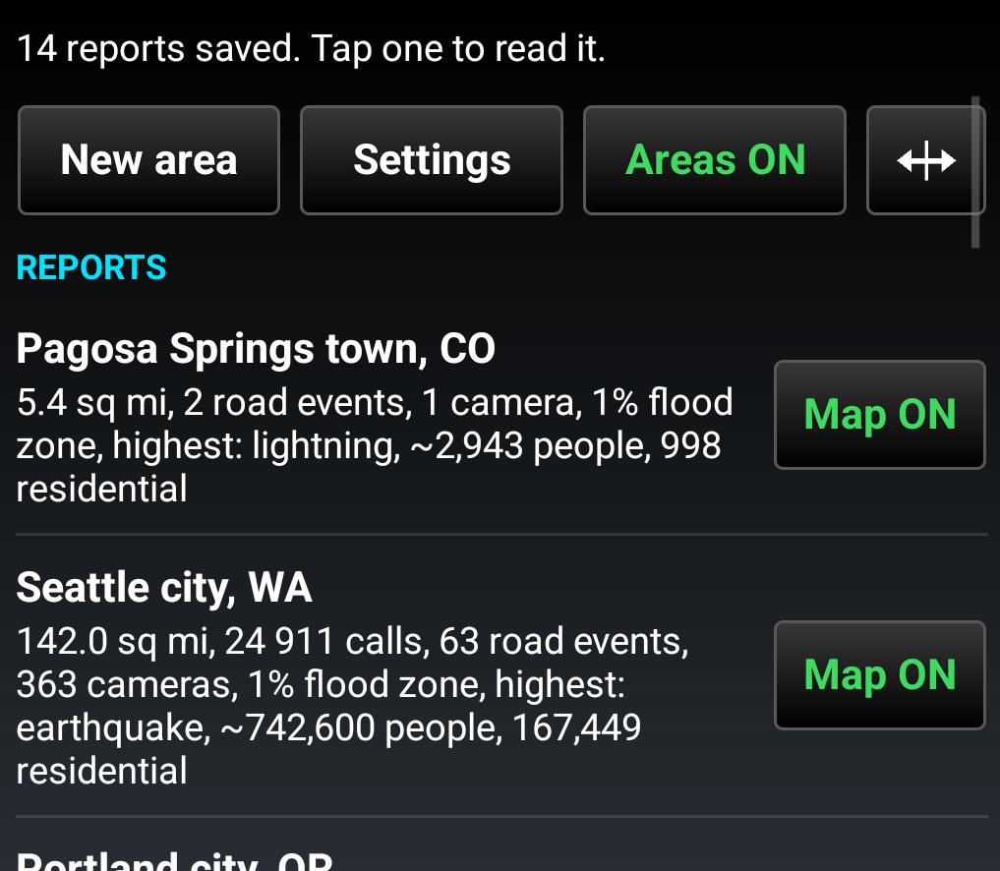
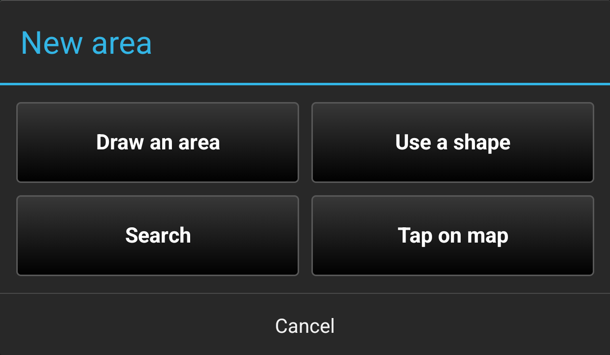
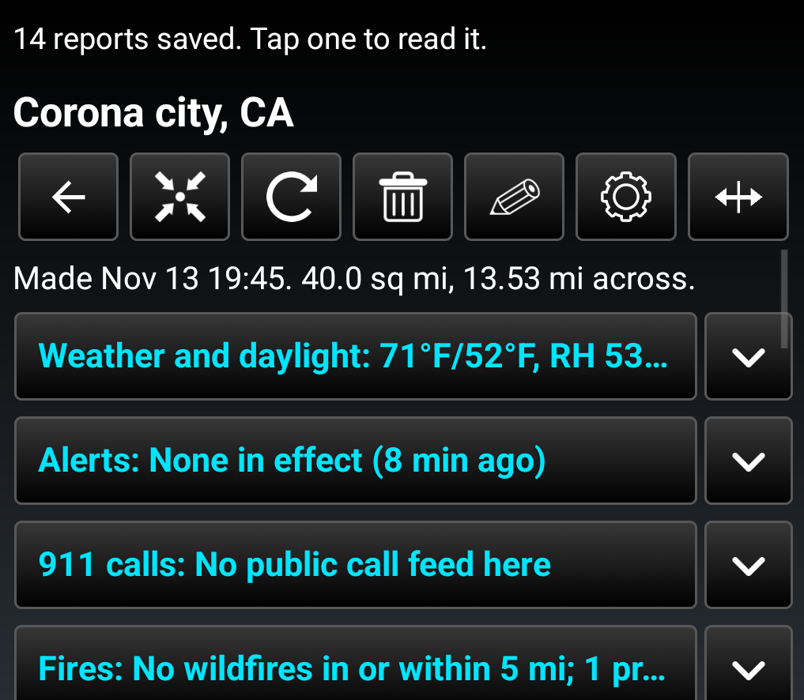
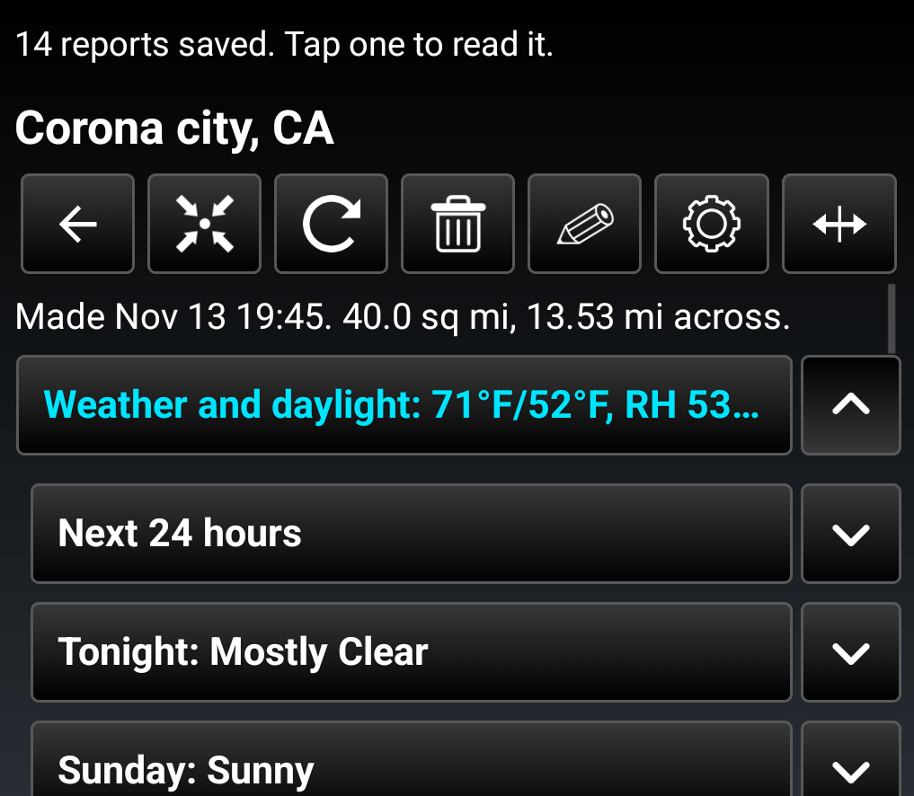
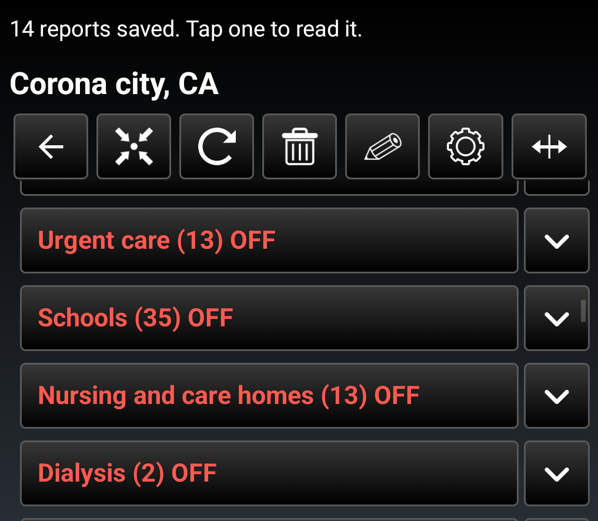
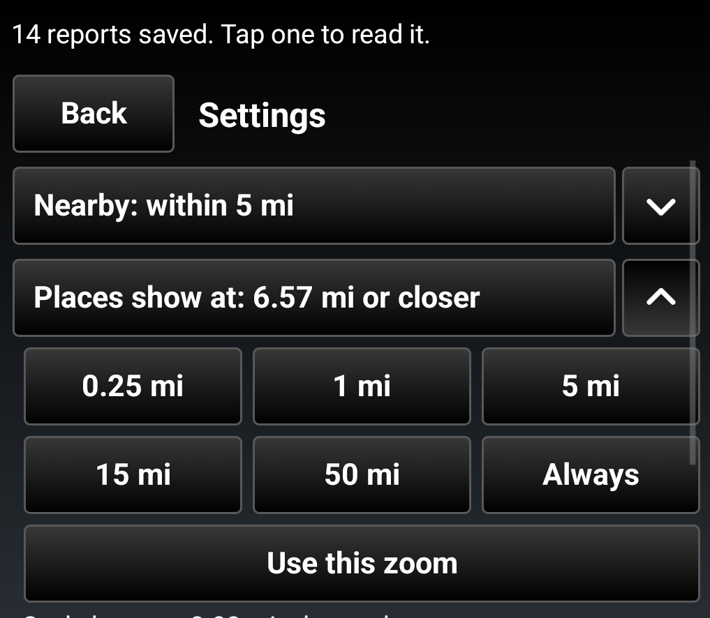

**Download Sit Rep 0.1** (pick the one matching your ATAK-CIV version, sideload, then load it in ATAK's Plugins manager):

- **ATAK-CIV 5.6:** https://github.com/takwerx/sit-rep/releases/download/v0.1/ATAK-Plugin-SitRep-0.1--5.6.0-civ-release.apk
- **ATAK-CIV 5.7:** https://github.com/takwerx/sit-rep/releases/download/v0.1/ATAK-Plugin-SitRep-0.1--5.7.0-civ-release.apk
- **ATAK-CIV 5.8:** https://github.com/takwerx/sit-rep/releases/download/v0.1/ATAK-Plugin-SitRep-0.1--5.8.0-civ-release.apk

All releases: https://github.com/takwerx/sit-rep/releases

# Sit Rep 0.1: User Guide

Sit Rep makes a situation report for any area you choose. It asks the public
agency sources for that area and writes a read-only report that you can save,
refresh and open again with no network.

- **What is happening now:** weather, alerts, 911 calls where an agency
  publishes them, wildfires, evacuations, road events, airspace, cameras,
  disaster declarations.
- **Who and what is here:** jurisdiction, people, hazard ratings, flood zones,
  structures, terrain, radio sites.
- **Places that matter:** hospitals, schools, care homes, shelters, stations,
  power, dams and more, each one a switch to put them on the map.
- **History:** past wildfires, firefighter fatalities and entrapments.

## Before you start

- **Match the plugin to your ATAK version.** Sit Rep 0.1 is published for
  ATAK-CIV 5.6, 5.7 and 5.8. Pick the download for the version on your device.
- **A network connection makes the report.** A saved report opens with no
  network. Live sections (alerts, fires, weather) show their age.
- **Facts, not judgments.** Every line is what an agency published. Where a
  source does not cover a place, the report says "Not published here".
- **The other takwerx plugins are the detail.** Each section ends with an Open
  or Get button for the plugin that shows the same data in full.

Load Sit Rep from ATAK's Plugins manager, then open it from the toolbar with
the SITREP icon (a clipboard, binoculars and a radio).

## The main screen

- **New area** makes a report.
- **Settings** holds the Nearby distance, the zoom at which places show, and
  the map key.
- **Areas ON / OFF** shows or hides the outlines of saved reports on the map.
- The arrows button makes the pane wide or half width.
- **Reports** lists every saved report, newest first, with its main numbers.
  **Map ON / OFF** on a row shows or hides that report on the map.
- Tap a report to read it.

## Make a report

Tap **New area** and choose how to give the area:

- **Draw an area:** tap each corner on the map, then tap the first point to
  close it.
- **Use a shape:** tap a polygon, circle or rectangle already on the map.
- **Search:** type a city, town, community or county and pick it from the list.
- **Tap on map:** tap a point and choose the county or city there.

The report fills in section by section. The status line counts the sections
still loading.

## Read a report

The buttons across the top:

- **Back** to the list. **Go to** puts the area in view.
- **Refresh** runs the live sections again for the same area.
- **Delete** removes the report. **Rename** (the pencil) changes its name.
- **Settings** (the gear). **Wide or half width** (the arrows).

Each section is one row. Its head is the short answer. Tap the row to open it.

## Open a section

An open section shows its detail. Groups inside it (here "Next 24 hours") open
the same way.

- Live sections show their age, for example "(8 min ago)".
- A source that did not answer says "Not available". Tap **Refresh** to try it
  again. The rest of the report stays.
- "Not published here" means no agency publishes this for the place. It is not
  the same as "none".
- A line with a web page opens it in the device's browser.

## Places on the map

In the **Places** section, each category is a switch with its count: **OFF**
in red, **ON** in green. Tap the name to put that category on the map. Tap the
arrow to list the places, nearest first.

Tap a place on the map for its radial: **Details** (opens it in the report),
**Bloodhound**, **Range and Bearing** and **polar coordinates**.

Places show only at the zoom you set in Settings, so the map stays readable.
The status line says when places are hidden.

## Settings

- **Nearby:** how far around the area Sit Rep looks for hospitals, shelters,
  fires, history and other things outside the area itself.
- **Places show at:** the scale bar distance at which places appear on the
  map. Pick a value, **Always**, or **Use this zoom** for the zoom you have now.
- **Map key:** what each map symbol means.

This guide is also in ATAK as a PDF: **Settings > Tool Preferences > Sit Rep >
Plugin Documentation**.
